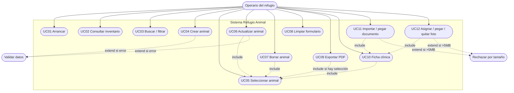

# Casos de uso — Refugio Animal

## 1. Actores

| Actor | Descripción |
| --- | --- |
| **Operario del refugio** | Usa la aplicación de escritorio para consultar y mantener inventario, clínica y adjuntos. |
| **Sistema** | Validaciones, diálogos, copia de adjuntos, generación PDF. |

Un solo actor humano (sin roles).

---

## 2. Diagrama de casos de uso

---

## 3. Catálogo

### UC01 — Arrancar la aplicación

| Campo | Detalle |
| --- | --- |
| Flujo | Ejecutar `app.py` → `cargar_inventario()` → ventana y tabla. |
| Postcondición | Inventario desde `inventario.json` (o ejemplo sembrado la primera vez). |
| RF | RF-14 |

### UC02 — Consultar inventario

| Campo | Detalle |
| --- | --- |
| Flujo | Ver tabla y barra de estado. |
| RF | RF-01, RF-12 |

### UC03 — Buscar / filtrar

| Campo | Detalle |
| --- | --- |
| Flujo | Texto en nombre y/o especie; tabla se actualiza. |
| RF | RF-09, RF-10 |

### UC04 — Crear animal

| Campo | Detalle |
| --- | --- |
| Flujo | Formulario → **Crear** → validar → nuevo ID → refrescar y limpiar. |
| Alternativa | Error de validación → `showerror`. |
| RF | RF-04, RF-08, RF-13 |

### UC05 — Seleccionar animal

| Campo | Detalle |
| --- | --- |
| Flujo | Clic en fila → formulario + miniatura de foto + resumen clínico en estado. |
| RF | RF-05, RF-19 |

### UC06 — Actualizar animal

| Campo | Detalle |
| --- | --- |
| Incluye | UC05 |
| Flujo | Editar → **Actualizar** (se conservan tratamientos/vacunas/docs/foto). |
| RF | RF-06, RF-08 |

### UC07 — Borrar animal

| Campo | Detalle |
| --- | --- |
| Incluye | UC05 |
| Flujo | **Borrar** → confirmar → elimina registro y carpeta `adjuntos/<id>/`. |
| RF | RF-07 |

### UC08 — Limpiar formulario

| Campo | Detalle |
| --- | --- |
| Flujo | **Limpiar**: campos vacíos, sin selección, panel foto vacío. |
| RF | RF-11 |

### UC09 — Exportar fichas a PDF

| Campo | Detalle |
| --- | --- |
| Flujo A | Con selección → una ficha (con foto y clínica si existen). |
| Flujo B | Sin selección → confirmar → todas las visibles (+ portada si >1). |
| RF | RF-15 |

### UC10 — Abrir ficha clínica

| Campo | Detalle |
| --- | --- |
| Incluye | UC05 |
| Flujo | **Ficha clínica / adjuntos** → pestañas Tratamientos, Vacunaciones, Documentos, Foto. |
| RF | RF-16 … RF-21 |

### UC10a — Alta de tratamiento / vacunación

| Campo | Detalle |
| --- | --- |
| Flujo | Rellenar campos → **Añadir**; o **Eliminar seleccionado**. |
| RF | RF-16, RF-17 |

### UC11 — Importar / pegar documento

| Campo | Detalle |
| --- | --- |
| Incluye | UC10 |
| Flujo A | **Importar documento...** → elegir archivo ≤ 5 MB → copia a `adjuntos/<id>/documentos`. |
| Flujo B | Copiar en Explorador (o texto/imagen) → **Pegar** / Ctrl+V. |
| Alternativa | > 5 MB o portapapeles vacío → error. |
| RF | RF-18, RF-20, RF-21 |

### UC12 — Asignar / pegar / quitar foto

| Campo | Detalle |
| --- | --- |
| Incluye | UC10 |
| Flujo | Importar, pegar (archivo o imagen) o quitar; se ve en diálogo, formulario y PDF. |
| RF | RF-19, RF-20, RF-21 |

---

## 4. Escenarios ejemplo

### Crear animal

1. Nombre=`Nube`, Especie=`Gato`, Edad=`2`, Peso=`3,8`, Color=`Gris`.  
2. **Crear** → ID 5.

### Pegar documento

1. En Explorador: Copiar `hoja_vacunacion_ejemplo.pdf` (carpeta `muestras/documentos`).  
2. Ficha clínica → Documentos → **Pegar**.  
3. Aparece en la lista; archivo en `adjuntos/<id>/documentos/`.

Diagramas de secuencia y actividades: [uml.md](uml.md).
