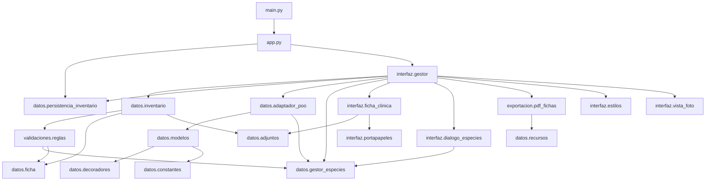
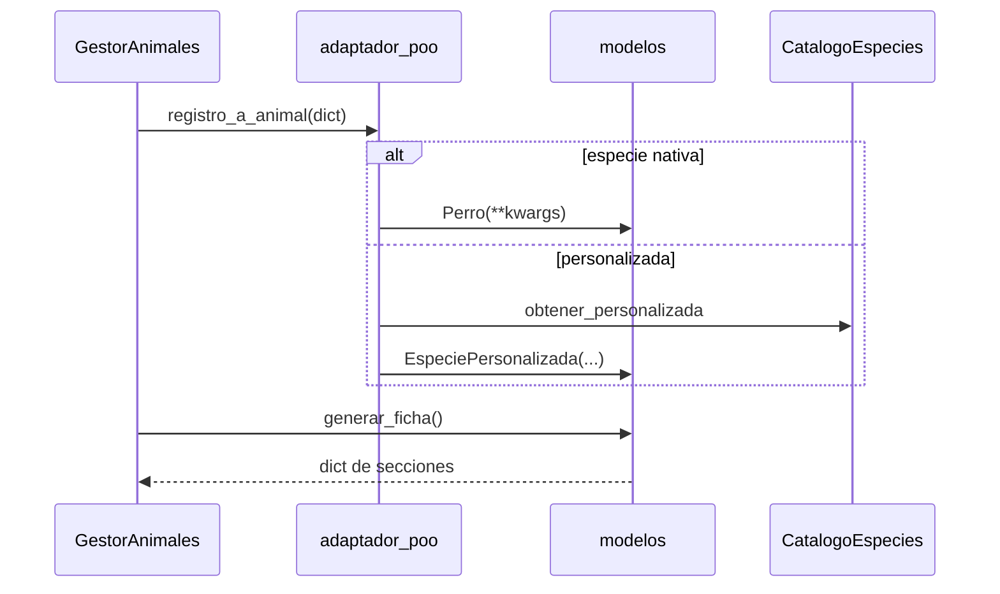
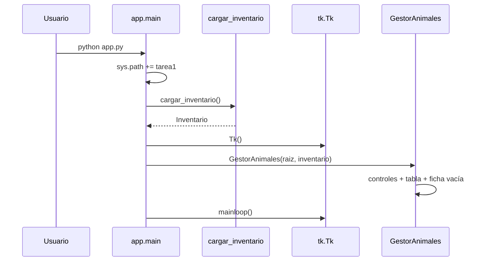

# Guía didáctica del código Python — Refugio Animal

Documento autónomo para estudiar el proyecto **Refugio Animal** (Tarea 1): arquitectura, cada módulo `.py`, programación orientada a objetos, flujos de la aplicación, decisiones de diseño, pruebas, glosario, preguntas de defensa y mapa de aprendizaje.

> **Alcance del análisis:** se han localizado y leído **39 archivos Python**. Las explicaciones se basan en el código ejecutado realmente, no solo en comentarios o documentación previa. No se ha modificado ningún archivo fuente del programa.

---

## Índice

1. [Visión general y arquitectura](#1-visión-general-y-arquitectura)
2. [Explicación de cada archivo Python](#2-explicación-de-cada-archivo-python)
3. [Capítulo especial de POO](#3-capítulo-especial-de-poo)
4. [Flujos completos de la aplicación](#4-flujos-completos-de-la-aplicación)
5. [Decisiones de diseño](#5-decisiones-de-diseño)
6. [Scripts auxiliares y pruebas](#6-scripts-auxiliares-y-pruebas)
7. [Glosario](#7-glosario-de-python-y-conceptos-técnicos)
8. [Preguntas para la defensa](#8-preguntas-para-preparar-la-defensa-del-proyecto)
9. [Mapa de aprendizaje](#9-mapa-de-aprendizaje)
10. [Anexo A — Plantillas detalladas](#anexo-a-plantillas-detalladas-de-funciones-núcleo)
11. [Anexo B — Tabla de archivos](#anexo-b-tabla-completa-de-archivos-py-analizados)
12. [Anexo C — Contadores](#anexo-c-contadores-del-análisis)
13. [Anexo D — Inventario AST](#anexo-d-inventario-exhaustivo-de-definiciones-ast)
14. [Limitaciones del análisis](#10-limitaciones-del-análisis-y-aspectos-que-conviene-revisar)

---

## 1. Visión general y arquitectura

### 1.1. Qué problema resuelve

**Refugio Animal** es una aplicación de escritorio para gestionar el inventario de animales de un refugio. Permite registrar, consultar, modificar y eliminar animales; filtrarlos; asociarles ficha clínica (tratamientos, vacunas, documentos y foto); definir especies personalizadas; mostrar una ficha informativa basada en clases POO; y exportar fichas a PDF.

### 1.2. Funcionalidades principales

| Área | Qué ofrece |
| --- | --- |
| CRUD | Crear, leer, actualizar y borrar animales |
| Persistencia | Guardar/cargar inventario en `datos/inventario.json` |
| Especies | 5 nativas + personalizadas en `especies_personalizadas.json` |
| POO | Ficha polimórfica (`generar_ficha`) vía adaptador |
| Clínica | Tratamientos, vacunas, documentos y foto |
| Adjuntos | Archivos físicos en `adjuntos/<id>/` |
| Exportación | PDF con `fpdf2` |
| Pruebas | Batería `unittest` + `ejecutar_tests.py` |

### 1.3. Organización del proyecto

```text
tarea1/
├── app.py / main.py          # Arranque
├── datos/                    # Modelo, CRUD, POO, persistencia, adjuntos
├── validaciones/             # Reglas de dominio
├── interfaz/                 # Tkinter
├── exportacion/              # PDF
├── adjuntos/                 # Archivos importados
├── muestras/                 # Material de prueba
├── tests/                    # Unit tests
├── docs/                     # Documentación
└── scripts auxiliares        # ejecutar_tests, probar_crud, generar_*.py
```

### 1.4. Responsabilidad de cada paquete

| Paquete / carpeta | Responsabilidad |
| --- | --- |
| `datos/` | Inventario (dicts), clases POO, adaptador, especies, ficha clínica, adjuntos, JSON |
| `validaciones/` | Limpiar y comprobar datos antes de guardarlos |
| `interfaz/` | Ventanas, eventos, diálogos; no valida la lógica de negocio por sí sola |
| `exportacion/` | Generar PDF a partir de diccionarios |
| `tests/` | Comprobar el comportamiento sin sustituir la app |
| `muestras/` | Fotos/docs de ejemplo para importar |

### 1.5. Por qué se divide el código

Separar módulos evita un único archivo gigante, permite probar el CRUD sin abrir Tkinter, facilita cambiar la interfaz sin tocar la validación, y deja clara la frontera entre “datos” y “pantalla”.

### 1.6. Capas conceptuales

| Capa | Qué es en este proyecto | Ejemplo |
| --- | --- | --- |
| Interfaz gráfica | Controles Tkinter y eventos | `GestorAnimales._crear` |
| Lógica de negocio / CRUD | Operaciones sobre el inventario | `crear_animal`, `borrar_animal` |
| Modelo de datos | Estructura de cada registro | `Dict[int, Dict[str, Any]]` |
| Persistencia | Guardar/cargar en disco | `guardar_inventario` |
| Validación | Rechazar datos incorrectos | `validar_datos` |
| Adaptación | Dict → objeto POO | `registro_a_animal` |
| Exportación | Documentos de salida | `exportar_fichas_pdf` |

### 1.7. Diagrama Mermaid de dependencias reales



### 1.8. Inventario = diccionarios; POO = objetos temporales

El enunciado pide un inventario basado en **diccionarios**. Las clases de `modelos.py` **no** sustituyen ese inventario: se crean bajo demanda (al mostrar la ficha POO) mediante `registro_a_animal`. El JSON guarda diccionarios, no instancias Python.

## 2. Explicación de cada archivo Python

Convención de la plantilla usada en cada definición:

1. ¿Para qué sirve?
2. ¿Cuándo se ejecuta?
3. Parámetros
4. Código paso a paso
5. Valor devuelto
6. Efectos secundarios
7. Relacionados
8. Ejemplo
9. Conceptos Python

Si una función solo aparece en tests o scripts, se indica expresamente.

### 2.1. `app.py`

#### A. Identificación

| Campo | Valor |
| --- | --- |
| Ruta | `app.py` |
| Paquete | raíz del programa |
| Responsabilidad | Punto de entrada: preparar rutas, cargar inventario, abrir Tkinter |
| Problema que resuelve | Arrancar la aplicación de forma uniforme desde `tarea1/` o desde el repo |
| Por qué es independiente | Separa el “arranque” de la lógica y de la GUI |
| Usa | `sys`, `pathlib.Path`, `tkinter`, `datos.persistencia_inventario`, `interfaz.gestor` |
| Dependen de él | `main.py` (importa `main`) |

#### B. Imports

1. **`from __future__ import annotations`** — biblioteca estándar. Retrasa la evaluación de anotaciones de tipos. Facilita escribir tipos modernos.
2. **`import sys`** — biblioteca estándar. Sirve para manipular `sys.path` y que Python encuentre los paquetes `datos`, `interfaz`, etc.
3. **`from pathlib import Path`** — biblioteca estándar. Representa rutas de forma portable. Se usa para calcular `RAIZ_PROGRAMA`.
4. **`import tkinter as tk`** — biblioteca estándar (GUI). El alias `tk` acorta el código (`tk.Tk()`). Si se eliminara, no habría ventana.
5. **`from datos.persistencia_inventario import cargar_inventario`** — proyecto. Carga o siembra el inventario JSON.
6. **`from interfaz.gestor import GestorAnimales`** — proyecto. Construye la ventana principal.

**Sobre `sys.path.insert`:** si ejecutas `python tarea1/app.py` desde la raíz del repo, sin añadir la carpeta `tarea1` a `sys.path`, fallarían imports como `from datos...`.

**Import relativo vs absoluto:** aquí no hay punto (`.`); son imports absolutos desde la raíz del programa.

#### C. Constante `RAIZ_PROGRAMA`

```python
RAIZ_PROGRAMA = Path(__file__).resolve().parent
if str(RAIZ_PROGRAMA) not in sys.path:
    sys.path.insert(0, str(RAIZ_PROGRAMA))
```

- `__file__` es la ruta del propio `app.py`.
- `.resolve().parent` obtiene la carpeta `tarea1/`.
- Se inserta al inicio de `sys.path` para priorizar esos módulos.

#### `main()`

**1. ¿Para qué sirve?** Orquesta el arranque completo.

**2. ¿Cuándo se ejecuta?** Al lanzar el programa (`python app.py`) o desde `main.py`.

**3. Parámetros:** ninguno.

**4. Paso a paso:**
1. `inventario = cargar_inventario()` lee `datos/inventario.json` (o siembra ejemplos).
2. `raiz = tk.Tk()` crea la ventana raíz de Tkinter.
3. `GestorAnimales(raiz, inventario)` construye controles y enlaza el inventario en memoria.
4. `raiz.mainloop()` entra en el bucle de eventos (espera clics, teclas, etc.).

**5. Devuelve:** `None`.

**6. Efectos:** abre ventana; puede crear/leer JSON; bloquea hasta cerrar la app.

**7. Relacionados:** `cargar_inventario`, `GestorAnimales.__init__`.

**8. Ejemplo:** `python app.py` desde `tarea1/`.

**9. Conceptos:** módulos, `if __name__ == "__main__"`, bucle de eventos.

#### Bloque `if __name__ == "__main__"`

Solo llama a `main()` cuando el archivo se ejecuta directamente, no cuando se importa (`from app import main`).

### 2.2. `main.py`

#### A. Identificación

Alias de arranque. Responsabilidad: delegar en `app.main`. Existe para ofrecer un segundo nombre de entrada familiar (`python main.py`).

#### B. Imports

- `from app import main` — importa la función `main` del módulo `app`.

#### C. Definiciones

No define funciones propias. Solo:

```python
if __name__ == "__main__":
    main()
```

Si se eliminara, bastaría con `app.py`; no forma parte del flujo interno de la GUI.

### 2.3. `datos/__init__.py`

#### A. Identificación

Marca `datos` como **paquete** e reexporta el API CRUD más usado.

#### B. Imports

- `from datos.constantes import ESPECIES`
- `from datos.inventario import actualizar_animal, animales_iniciales, borrar_animal, crear_animal, leer_animal`

`__all__` lista los nombres públicos al hacer `from datos import *`.

#### C. Definiciones

No define funciones. Solo reexporta. Facilita imports cortos en demos, aunque la app principal suele importar desde submódulos concretos.

### 2.4. `datos/constantes.py`

#### A. Identificación

Constantes del dominio: especies nativas y límites de peso.

#### B. Imports

Ninguno.

#### C. Constantes

- **`ESPECIES` / `ESPECIES_NATIVAS`:** tupla `("Perro", "Gato", "Conejo", "Loro", "Hámster")`. Son las especies con clase POO propia. Las personalizadas **no** se añaden aquí.
- **`PESO_MIN_KG = 0.01`**, **`PESO_MAX_KG = 100.0`:** usados en `validar_datos` y en el setter de peso de `AnimalRefugio`.

**Conceptos:** tupla (inmutable), constantes por convención en MAYÚSCULAS.

### 2.5. `datos/decoradores.py`

#### A. Identificación

Decorador didáctico `@cuenta_usos` para demostrar decoradores propios además de `@property` / `@abstractmethod`.

#### B. Imports

- `from __future__ import annotations`
- `from functools import wraps` — preserva el nombre/docstring del método original.
- `from typing import Any, Callable, TypeVar` — tipado genérico del decorador.

#### `cuenta_usos(metodo)`

**1. Sirve para** contar cuántas veces se llama un método de instancia.

**2. Se ejecuta** al **definir** la clase (cuando Python aplica el decorador) y la *envoltura* se ejecuta en cada llamada.

**3. Parámetro `metodo`:** la función original.

**4. Paso a paso:** crea `envoltura(self, *args, **kwargs)` que:
1. Construye el nombre `_usos_<nombre_metodo>`.
2. Lee el contador con `getattr(..., 0)` y lo incrementa con `setattr`.
3. Llama al método original y devuelve su resultado.

**5. Devuelve** la función envoltorio (mismo contrato tipado con `TypeVar`).

**6. Efecto:** añade atributo dinámico en la instancia (p. ej. `_usos_info_basica`).

**7. Uso real:** decora `AnimalRefugio.info_basica`. Comprobado en `tests/test_modelos_poo.py`.

**8. Ejemplo:** tras dos `perro.info_basica()`, `perro._usos_info_basica == 2`.

**9. Conceptos:** decoradores, `*args`/`**kwargs`, `functools.wraps`, closures.

### 2.6. `datos/recursos.py`

#### A. Identificación

Localiza el logo del refugio (`refugio.png` / `.jpg` / …) en `tarea1/` o en la raíz del repo.

#### B. Imports

`Path`, `Optional` de `typing`.

#### `ruta_logo_refugio() -> Optional[Path]`

**1.** Busca el logo.

**2.** La llaman `GestorAnimales._mostrar_logo_cabecera` y las funciones de logo del PDF.

**3.** Sin parámetros.

**4.** Recorre bases `_RAIZ_PROGRAMA` y `_RAIZ_REPO` y nombres en `_NOMBRES_LOGO`; si `candidata.is_file()`, la devuelve.

**5.** `Path` o `None`.

**6.** Solo lectura de disco.

**Uso:** interfaz y exportación PDF.

### 2.7. `datos/inventario.py`

#### A. Identificación

| Campo | Valor |
| --- | --- |
| Ruta | `datos/inventario.py` |
| Responsabilidad | Inventario inicial + operaciones CRUD sobre diccionarios |
| Por qué existe | Cumple el enunciado (CRUD con dicts) separado de la GUI |
| Usa | `deepcopy`, `datos.adjuntos`, `datos.constantes`, `datos.ficha`, `validaciones.reglas` |
| Dependen | `GestorAnimales`, `probar_crud.py`, tests, `persistencia_inventario` (tipo/`animales_iniciales`) |

Tipo alias: `Inventario = Dict[int, Dict[str, Any]]` — clave = ID entero; valor = ficha del animal.

#### B. Imports

| Import | Origen | Para qué |
| --- | --- | --- |
| `deepcopy` | stdlib `copy` | Copias profundas al leer (evitar mutar el original) |
| `Any`, `Dict` | `typing` | Anotaciones |
| `borrar_adjuntos_animal` | proyecto | Borrar carpeta de archivos al eliminar animal |
| `ESPECIES` | proyecto | Reexportado en `__all__` (compatibilidad) |
| `asegurar_campos_clinicos`, `ficha_vacia_clinica` | proyecto | Garantizar campos clínicos |
| `validar_datos` | proyecto | Validar antes de crear/actualizar |

#### `_ejemplo(base, **clinica)`

**1.** Auxiliar privada: une datos básicos + ficha clínica vacía + overrides clínicos.

**2.** Solo la llama `animales_iniciales`.

**3.** `base` (dict obligatorio); `**clinica` (opcionales: vacunaciones, tratamientos…).

**4.** `{**base, **ficha_vacia_clinica()}`, luego `update(clinica)`, luego `asegurar_campos_clinicos`.

**5.** Devuelve un dict registro completo.

**6.** Sin efectos de disco.

#### `animales_iniciales() -> Inventario`

**1.** Devuelve el inventario de ejemplo (Luna, Misi, Kiko, Toby).

**2.** La usan `cargar_inventario` (siembra), tests y demos. **No** la llama directamente la GUI tras el arranque normal si ya existe JSON.

**3.** Sin parámetros.

**4.** Construye un dict con IDs 1–4 usando `_ejemplo`.

**5.** `Inventario` nuevo en memoria.

**8. Ejemplo:** `inv = animales_iniciales(); print(inv[1]["nombre"])  # Luna`

#### `crear_animal(datos, inventario) -> int`

**1.** Valida y añade un animal; asigna el siguiente ID.

**2.** Desde `GestorAnimales._crear`, `probar_crud.py` y tests.

**3.** `datos`: dict del formulario; `inventario`: dict mutable de animales.

**4.**
```python
registro = validar_datos(datos)
nuevo_id = max(inventario, default=0) + 1
inventario[nuevo_id] = registro
return nuevo_id
```
- Si el inventario está vacío, `max(..., default=0)` evita error y el primer ID es 1.
- `validar_datos` puede lanzar `ValueError`.

**5.** Entero = nuevo ID.

**6.** Modifica `inventario` en memoria. **No** escribe JSON (eso lo hace la GUI con `guardar_inventario`).

#### `leer_animal(animal_id, inventario) -> Dict`

**1.** Devuelve una **copia profunda** del registro.

**2.** Desde `_seleccionar` y tests.

**3.** `animal_id` int; `inventario` Inventario.

**4.** Si el ID no está, `raise ValueError`. Si está, `deepcopy` + `asegurar_campos_clinicos`.

**¿Por qué deepcopy?** Si devolviera el dict original, cambiar el formulario podría mutar el inventario sin pasar por `actualizar_animal`.

**5.** Dict copia (nunca `None`; lanza excepción si falta).

#### `actualizar_animal(animal_id, datos, inventario) -> None`

**1.** Sustituye el registro tras validar; **conserva clínica** si el formulario no la trae.

**2.** Desde `_actualizar` y tests.

**4.** Si no existe ID → error. Fusiona foto/tratamientos/vacunaciones/documentos desde `datos` o desde el registro actual. Llama `validar_datos(..., especie_previa=...)` para permitir especies desactivadas al editar animales antiguos.

**6.** Mutación en memoria del inventario.

#### `borrar_animal(animal_id, inventario) -> Dict`

**1.** Elimina el animal y sus adjuntos en disco.

**2.** Desde `_borrar`.

**4.** `pop` del dict; `borrar_adjuntos_animal(animal_id)`; devuelve el dict eliminado.

**6.** Memoria + borrado de carpeta `adjuntos/<id>/`.

### 2.8. `datos/persistencia_inventario.py`

#### A. Identificación

Persistencia JSON del inventario (separada del catálogo de especies). Escritura **atómica** (temp + `replace`).

#### B. Imports

`json`, `tempfile`, `deepcopy`, `Path`, tipos; `asegurar_campos_clinicos`, `Inventario`, `animales_iniciales`.

`json` convierte entre texto JSON y estructuras Python (`dumps`/`loads`).

#### Constantes

`RUTA_POR_DEFECTO = .../datos/inventario.json`

#### `_a_jsonable(inventario)`

Convierte claves `int` → `str` (JSON solo admite claves string) y hace deepcopy de cada registro.

#### `_desde_jsonable(datos)`

Invierte el proceso: exige un objeto/dict; ignora claves no convertibles a int y registros no-dict; asegura campos clínicos.

#### `guardar_inventario(inventario, ruta=None) -> Path`

**1.** Guarda el inventario en UTF-8.

**2.** Tras crear/actualizar/borrar/cambiar clínica (`GestorAnimales._persistir_inventario`) y al sembrar.

**4.** Crea directorio padre; `json.dumps(..., ensure_ascii=False, indent=2)`; escribe en `NamedTemporaryFile` en el mismo directorio; `tmp_path.replace(destino)` (atómico en el mismo volumen).

**Ventaja de atómico:** si el programa se corta a mitad, no deja un JSON a medias.

#### `cargar_inventario(ruta=None) -> Inventario`

**1.** Carga desde disco o siembra ejemplo.

**2.** Arranque (`app.main`).

**4.**
- Si no existe archivo → `animales_iniciales()` + `guardar_inventario`.
- Si existe → `json.loads`; si está corrupto → **no sobrescribe** el archivo; arranca con ejemplo en memoria.
- Si el dict queda vacío → siembra y guarda.

**Importante para la defensa:** JSON corrupto no se borra automáticamente.

### 2.9. `datos/ficha.py`

#### A. Identificación

Normaliza y asegura la parte clínica del registro (foto, tratamientos, vacunas, documentos).

#### B. Imports

`deepcopy`, tipado.

#### Constantes

`CAMPOS_CLINICOS = ("foto", "tratamientos", "vacunaciones", "documentos")` — definida; el código de normalización trabaja campo a campo. Si no se usa en otros módulos vía import, sigue documentando el contrato clínico.

#### `ficha_vacia_clinica()`

Devuelve `{"foto": "", "tratamientos": [], "vacunaciones": [], "documentos": []}`.

#### `asegurar_campos_clinicos(registro)`

Si falta una clave o es `None`, la rellena con deepcopy del valor por defecto. Devuelve el mismo dict (mutado). Usada al leer, cargar JSON y abrir ficha clínica.

#### `normalizar_tratamientos(raw)` / `normalizar_vacunaciones(raw)` / `normalizar_documentos(raw)`

**1.** Convierten datos crudos en listas de dicts limpios o lanzan `ValueError`.

**2.** Las llama `validar_datos`.

**Reglas clave:**
- Tratamiento: descripción obligatoria.
- Vacuna: nombre de vacuna obligatorio.
- Documento: nombre y ruta obligatorios.

**Conceptos:** validación defensiva, listas de diccionarios anidados.

### 2.10. `datos/adjuntos.py`

#### A. Identificación

Copia fotos/documentos a `adjuntos/<id_animal>/` con límite de 5 MiB.

#### B. Imports

`shutil` (copiar/borrar árboles), `date`/`datetime`, `Path`.

#### Constantes

`RAIZ_ADJUNTOS`, `TAMANO_MAX_BYTES`, `TAMANO_MAX_MB`.

#### Funciones

| Función | Uso |
| --- | --- |
| `carpeta_animal(id)` | Crea/devuelve carpeta del animal |
| `comprobar_tamano(ruta)` | Error si > 5 MB |
| `_destino_unico(dir, nombre)` | Evita sobrescribir: `a.png`, `a_2.png`… |
| `importar_archivo(id, origen, subcarpeta="")` | Copia con `shutil.copy2` |
| `guardar_bytes(id, contenido, nombre, subcarpeta="")` | Guarda pegados desde portapapeles |
| `registrar_documento` / `registrar_documento_bytes` | Devuelven dict `{nombre, ruta, fecha}` |
| `registrar_foto` / `registrar_foto_bytes` | Devuelven ruta string |
| `borrar_adjuntos_animal(id)` | `shutil.rmtree` de la carpeta |

**Distinción JSON vs disco:** el JSON guarda metadatos (ruta, nombre, fecha); el archivo binario vive en `adjuntos/`.

### 2.11. `datos/gestor_especies.py`

#### A. Identificación

Catálogo de especies nativas + personalizadas con persistencia en `especies_personalizadas.json` y patrón **singleton** (`get_catalogo`).

#### B. Imports

`json`, `tempfile`, `Path`, tipado, `ESPECIES` como `ESPECIES_NATIVAS`.

#### Funciones de módulo

- **`normalizar_nombre(nombre)`:** `strip().casefold()` para comparar sin distinguir mayúsculas (ojo: no quita tildes → `Hámster` ≠ `Hamster`).
- **`get_catalogo(ruta=None)`:** singleton global, o instancia nueva si se pasa ruta (tests).
- **`reiniciar_catalogo_global()`:** solo para tests.
- **`especies_usadas_en_inventario(inventario)`:** lista de especies presentes; la usa el diálogo al eliminar.

#### Clase `CatalogoEspecies`

**Constructor `__init__(ruta)`:** guarda ruta, lista `_personalizadas`, llama `cargar()`.

| Método | Responsabilidad |
| --- | --- |
| `cargar` | Lee JSON; si no existe crea `[]`; corrupto → lista vacía **sin sobrescribir** |
| `_guardar_seguro` | Escritura atómica |
| `_persistir` | Guarda `_personalizadas` |
| `_normalizar_registro` | Limpia campos; opcionalmente exige completitud |
| `nativas` / `es_nativa` | Consulta especies fijas |
| `personalizadas` | Copia superficial de la lista |
| `_buscar_indice` | Índice por nombre normalizado o -1 |
| `obtener_personalizada` | Dict o None; filtro `solo_activas` |
| `nombres_activos_para_alta` | Nativas + personalizadas activas (Combobox alta) |
| `nombres_para_filtro` / `nombres_conocidos` | Incluyen inactivas |
| `especie_permitida_en_alta` / `especie_conocida` | Booleanos para validación |
| `anadir` | Alta; rechaza nativas y duplicados |
| `actualizar` | Edición / rename con validaciones |
| `desactivar` / `activar` | Flag `activa` |
| `eliminar` | Borra si no hay animales en uso |

**Importación circular:** `validar_datos` importa `get_catalogo` **dentro** de la función (diferida) para reducir acoplamiento al importar el módulo.

### 2.12. `datos/modelos.py`

> Explicación profunda también en la [sección 3](#3-capítulo-especial-de-poo). Aquí se documenta el inventario de definiciones.

#### A. Identificación

Modelo POO didáctico: ABC `AnimalRefugio`, especies nativas y `EspeciePersonalizada`. El CRUD **no** almacena estas instancias.

#### B. Imports

- `math` — `math.isfinite` en validación de peso.
- `ABC`, `abstractmethod` — clase abstracta.
- `Any`, `Dict`, `Type` — tipado.
- `PESO_*` — límites.
- `cuenta_usos` — decorador.

#### Clase `AnimalRefugio(ABC)`

Atributos de clase: `ESPECIE`, `EDAD_MINIMA`, `EDAD_MAXIMA`.

**`__init__(nombre, edad, peso, color, observaciones="")`:** asigna vía propiedades (dispara setters).

**Propiedades** `nombre`, `edad`, `peso`, `color`, `observaciones` (+ setters con validación). `especie` solo lectura desde `ESPECIE`.

**`info_basica()`** (con `@cuenta_usos`): resumen corto.

**Abstractos:** `hacer_sonido`, `tipo_alimentacion`, `cuidados_especificos`.

**`generar_ficha()`:** dict con claves `generales`, `comportamiento`, `alimentacion`, `cuidados`.

**`campos_desde_dict(cls, datos)`:** `@classmethod` — extrae kwargs comunes.

**`__str__`:** representación legible.

#### Subclases nativas

`Perro`, `Gato`, `Conejo`, `Loro`, `Hamster`: fijan `ESPECIE` e implementan los tres abstractos. **No definen `__init__`**: heredan el de la base.

#### `EspeciePersonalizada`

Sí define `__init__` con kwargs `nombre_especie`, `sonido`, `alimentacion`, `cuidados`. Sobrescribe `especie` como property de instancia. Implementa los abstractos leyendo la configuración.

#### `CLASES_POR_ESPECIE`

Mapa nombre → clase nativa. Lo usa el adaptador.

### 2.13. `datos/adaptador_poo.py`

#### A. Identificación

Puente dict ↔ objeto. Imprescindible porque el inventario es dict y la ficha POO necesita objetos.

#### B. Imports

`CLASES_POR_ESPECIE`, `AnimalRefugio`, `EspeciePersonalizada`.  
`TYPE_CHECKING` + import de `CatalogoEspecies` solo para tipos (no carga circular en runtime).  
Import **diferido** de `get_catalogo` dentro de `registro_a_animal` si no se pasa catálogo.

#### `registro_a_animal(registro, catalogo=None) -> AnimalRefugio`

1. Lee `especie`.
2. Si está en `CLASES_POR_ESPECIE` → `clase(**campos_desde_dict(registro))`.
3. Si no → busca en catálogo → `EspeciePersonalizada(...)`.
4. Si no hay config → `ValueError`.

Usada por `_actualizar_ficha_poo` y `resumen_polimorfico`.

#### `animal_a_campos(animal) -> Dict`

Exporta campos básicos. **En la app principal no se llama**; sí en `tests/test_modelos_poo.py`.

#### `resumen_polimorfico(registro, catalogo=None) -> str`

Demo de polimorfismo para la barra de estado al seleccionar. Usa `info_basica`, `hacer_sonido`, `tipo_alimentacion`.

### 2.14. `validaciones/__init__.py` y `validaciones/reglas.py`

#### `__init__.py`

Reexporta `validar_datos`.

#### `validar_datos(datos, *, especie_previa=None) -> Dict`

**1.** Contrato de dominio: limpia y valida el formulario/clínica.

**2.** La llaman `crear_animal` y `actualizar_animal` (no la GUI directamente, salvo tests).

**3.** `datos` dict; `especie_previa` opcional (solo keyword).

**4.** Paso a paso:
1. Import diferido del catálogo.
2. `strip` de textos; comprueba nombre, especie, color.
3. Especie permitida en alta **o** misma que `especie_previa` y conocida.
4. Edad: int real (no bool), 0–30.
5. Peso: float finito en rango.
6. Normaliza tratamientos/vacunas/documentos.
7. Devuelve registro limpio con campos clínicos.

**6.** No escribe disco; puede lanzar `ValueError`.

**Conceptos:** keyword-only (`*`), excepciones, separación UI/dominio.

### 2.15. `exportacion/__init__.py` y `exportacion/pdf_fichas.py`

#### `__init__.py` — carga perezosa

```python
def __getattr__(name: str):
    if name == "exportar_fichas_pdf":
        from exportacion.pdf_fichas import exportar_fichas_pdf
        return exportar_fichas_pdf
    raise AttributeError(...)
```

Así la GUI no exige `fpdf2` hasta exportar. `GestorAnimales._exportar_pdf` importa directamente `pdf_fichas` (también perezoso, dentro del método).

#### `pdf_fichas.py`

**Dependencia externa:** `fpdf` (`fpdf2`). Opcional Pillow para miniaturas.

| Símbolo | Rol |
| --- | --- |
| `_texto_pdf` | Adapta Unicode a latin-1/Helvetica |
| `PdfFichas(FPDF)` | PDF A4, pie con número de página |
| `_campo` | Etiqueta + valor |
| `_preparar_imagen_para_pdf` | Miniatura temporal si hace falta |
| `_dibujar_imagen` / `_dibujar_logo` / `_dibujar_foto` | Embebido de imágenes |
| `_dibujar_ficha` | Una página por animal |
| `_seccion_lista` | Tratamientos/vacunas/docs |
| `_portada` | Portada si hay varias fichas |
| `_iter_animales` | Itera IDs ordenados o lista dada |
| `exportar_fichas_pdf` | API pública: escribe PDF, devuelve total |

Escritura también vía temporal + `replace` (evita Permission denied en Windows si el PDF está abierto).

### 2.16. Paquete `interfaz/`

#### `interfaz/__init__.py`

Reexporta `GestorAnimales`.

#### `interfaz/estilos.py`

Unifica tipografía ttk/tk. En Windows usa Segoe UI; si no, Helvetica.

- `aplicar_tema(raiz)`: tema vista/xpnative/clam + estilos.
- `configurar_texto(widget)`: alinea `tk.Text` con la guía.

#### `interfaz/vista_foto.py` — `cargar_miniatura(ruta, max_lado=160)`

Intenta `tk.PhotoImage`; si falla, Pillow. Devuelve `(imagen_o_None, mensaje)`.

#### `interfaz/portapapeles.py`

Lectura multiplataforma con especialización Windows (`CF_HDROP` vía `ctypes`).

| Función | Rol |
| --- | --- |
| `_archivos_cf_hdrop` | Rutas del Explorador (solo Windows) |
| `_texto_tkinter` | Texto vía clipboard de Tk |
| `_imagen_pillow` | Imagen con ImageGrab |
| `leer_portapapeles` | `("archivos"\|"imagen"\|"texto"\|"vacio", dato)` |
| `imagen_a_png_bytes` | Serializa PIL → PNG |
| `primer_archivo_valido` | Primera ruta con extensión admitida |

#### `interfaz/gestor.py` — clase `GestorAnimales`

Ventana principal. Parámetros del constructor: `raiz`, `inventario`, `persistir=True`, `ruta_inventario=None` (los tests usan `persistir=False`).

| Método | Disparador / rol |
| --- | --- |
| `__init__` | Variables, tema, controles, tabla inicial |
| `_crear_controles` | Layout pack/grid, botones, Treeview, ficha POO |
| `_datos_del_formulario` | Lee Entry/Text; convierte edad/peso |
| `_id_seleccionado` | ID de fila o warning |
| `_crear` / `_actualizar` / `_borrar` | CRUD + persistir + refrescar |
| `_persistir_inventario` | `guardar_inventario` si `_persistir` |
| `_seleccionar` | Carga formulario + ficha POO + estado |
| `_poner_texto_ficha` / `_leer_texto_ficha` | Label o Text |
| `_mostrar_ficha_vacia` | Estado sin selección |
| `_actualizar_ficha_poo` | `registro_a_animal` + `generar_ficha` |
| `_abrir_ficha_clinica` | Diálogo clínico |
| `_abrir_gestion_especies` | Diálogo especies |
| `_refrescar_desplegables_especies` | Actualiza combos |
| `_tras_cambio_clinico` | Persistencia tras clínica |
| `_mostrar_logo_cabecera` / `_mostrar_foto_formulario` | Miniaturas |
| `_limpiar` | Vacía formulario y ficha |
| `_ids_visibles` / `_ids_seleccionados` | Para PDF |
| `_exportar_pdf` | Diálogo guardar + `exportar_fichas_pdf` |
| `_actualizar_tabla` | Filtro nombre + especie |

##### Recorrido de la clase

La clase coordina la ventana principal, pero delega las reglas del inventario
en `datos.inventario`, la validación en `validaciones` y el guardado en
`datos.persistencia_inventario`. Su flujo habitual es: leer los controles,
llamar la operación correspondiente, actualizar la interfaz y persistir los
cambios cuando proceda.

###### Inicialización: `__init__`

El constructor recibe la ventana Tkinter (`raiz`) y el diccionario
(`inventario`) que contiene los registros. `persistir=True` permite guardar los
cambios en disco; los tests pueden desactivarlo. `ruta_inventario` permite
indicar una ubicación alternativa.

Después, obtiene el catálogo de especies y crea las variables Tkinter
(`StringVar`) conectadas a los campos del formulario, la búsqueda, los filtros
y la barra de estado. También conserva referencias a las imágenes para que el
recolector de basura no las descarte. Por último, establece el título y el
tamaño de la ventana, aplica el tema, construye los controles y presenta la
tabla y la ficha vacías.

###### Construcción de controles: `_crear_controles`

Este método arma la interfaz y conecta los eventos con sus métodos:

1. Crea el contenedor y la cabecera con el logo y los títulos.
2. Construye el formulario de nombre, especie, edad, peso, color y
   observaciones. Los campos se vinculan a las variables Tkinter creadas en el
   constructor.
3. Conecta cada botón con la acción indicada por `command`: crear, actualizar,
   borrar, limpiar, exportar o abrir un diálogo.
4. Asocia la búsqueda y el filtro de especie a `_actualizar_tabla`, para
   refrescar los resultados al escribir o seleccionar una especie.
5. Prepara el panel donde se mostrará la ficha POO del animal seleccionado.
6. Crea el `Treeview`, que muestra los registros. Cada `iid` es el ID del
   animal y permite recuperar el registro seleccionado. Añade barras de
   desplazamiento y enlaza el evento de selección con `_seleccionar`.
7. Añade la etiqueta de estado para comunicar el resultado de las operaciones.

En Tkinter, `pack()` distribuye widgets dentro de un contenedor y `grid()` los
organiza en filas y columnas. Se pueden usar ambos en la ventana, pero no se
deben mezclar dentro del mismo contenedor.

Dentro de `_crear_controles`, `_bloque_etiqueta` construye un bloque para
mostrar texto breve y `_bloque_scroll` crea un área de texto con barra vertical
para contenido largo. Los campos `Text` de la ficha se dejan deshabilitados
para que la persona usuaria pueda consultarlos, pero no editarlos. Los nombres
`lbl_ficha_comportamiento`, `lbl_ficha_alimentacion` y `lbl_ficha_cuidados` se
conservan como alias de compatibilidad para código y tests existentes.

###### Lectura del formulario y operaciones CRUD

`_datos_del_formulario` reúne los valores de los controles en un diccionario.
Convierte la edad a entero y el peso a decimal; para este último acepta coma
decimal al sustituirla por un punto antes de convertir. Si la conversión falla,
lanza `ValueError` con un mensaje que explica el formato esperado.

`_id_seleccionado` obtiene el ID de la fila activa. Si no hay selección, muestra
una advertencia y devuelve `None`, para que la acción solicitada pueda detenerse
sin operar sobre un registro incorrecto.

- `_crear` lee los datos, llama a `crear_animal` y muestra un error si la
  validación falla. Si la creación funciona, guarda, refresca la tabla, limpia
  el formulario y comunica el ID creado.
- `_actualizar` requiere una fila seleccionada y delega el cambio en
  `actualizar_animal`. Si tiene éxito, persiste y refresca la tabla.
- `_borrar` requiere selección y confirmación explícita. Luego llama a
  `borrar_animal`; si funciona, guarda, refresca la tabla y limpia el formulario.
- `_persistir_inventario` no hace nada cuando `_persistir` es falso. Si el
  guardado falla, informa que los cambios siguen en memoria pero no se
  escribieron en disco.

###### Selección y ficha POO

`_seleccionar` se ejecuta al elegir una fila. Lee el registro con
`leer_animal`, carga sus valores en el formulario, muestra la foto y actualiza
la ficha POO. Si la especie del registro ya no está disponible para nuevas
altas, la añade al desplegable para poder seguir mostrando el animal existente.
También actualiza el estado con el resumen clínico y la información de especie.

`resumen_polimorfico` intenta generar el resumen mediante la capa POO. Si no
puede hacerlo por un `ValueError`, se muestra el nombre de la especie como
alternativa.

Los métodos estáticos `_poner_texto_ficha` y `_leer_texto_ficha` trabajan con
etiquetas (`Label`) y áreas de texto (`Text`). Para escribir en un `Text`, el
primero lo habilita temporalmente, reemplaza su contenido y vuelve a
deshabilitarlo. `_mostrar_ficha_vacia` presenta el aviso inicial, oculta las
secciones y borra sus textos.

`_actualizar_ficha_poo` transforma el diccionario en un objeto mediante
`registro_a_animal` y solicita `generar_ficha()`. Si ocurre un `ValueError`,
muestra el motivo y oculta las secciones; si funciona, muestra datos generales,
comportamiento, alimentación y cuidados específicos.

###### Diálogos, especies y fotografías

- `_abrir_ficha_clinica` requiere una selección, asegura que existan los campos
  clínicos del registro y abre el diálogo. `al_guardar` enlaza el guardado del
  diálogo con `_tras_cambio_clinico`.
- `_abrir_gestion_especies` abre la ventana del catálogo y le pasa una función
  de retorno para refrescar los desplegables cuando haya cambios.
- `_refrescar_desplegables_especies` actualiza las opciones de alta y filtro,
  conserva la selección actual cuando sea posible y vuelve a dibujar la tabla.
- `_tras_cambio_clinico` persiste los cambios clínicos y actualiza la foto o la
  selección si el animal todavía existe.
- `_mostrar_logo_cabecera` y `_mostrar_foto_formulario` cargan las miniaturas
  correspondientes. La referencia guardada en la instancia evita que la imagen
  desaparezca mientras se muestra.
- `_limpiar` vacía los campos, restaura la primera especie activa, quita la
  selección y muestra la ficha vacía.
- `_ids_visibles` y `_ids_seleccionados` extraen los IDs que se usarán al
  exportar.

###### Exportación PDF y actualización de la tabla

`_exportar_pdf` exporta los registros seleccionados. Si no hay selección,
ofrece exportar los registros actualmente visibles (es decir, los que pasan los
filtros). Si no hay ninguno visible, avisa y termina. Después solicita la ruta
del archivo e importa `exportar_fichas_pdf` dentro del método, de modo que la
dependencia PDF solo sea necesaria al exportar. Informa si falta `fpdf2` o si
ocurre un error durante la escritura; cuando funciona, muestra el resultado y la
ruta del archivo.

`_actualizar_tabla` elimina las filas mostradas y las vuelve a insertar a partir
del inventario. Usa `casefold()` para que la búsqueda por nombre no distinga
mayúsculas de minúsculas, y combina ese criterio con el filtro de especie.
Finalmente, actualiza la barra de estado con el total de registros y cuántos
son visibles.

#### `interfaz/dialogo_especies.py` — `DialogoGestionEspecies(Toplevel)`

CRUD visual de especies personalizadas (nativas solo lectura). Métodos: `_crear_controles`, `_refrescar_listas`, `_datos_formulario`, `_limpiar_formulario`, `_nueva`, `_al_seleccionar`, `_notificar_cambio`, `_guardar`, `_desactivar`, `_activar`, `_eliminar`.

#### `interfaz/ficha_clinica.py` — `DialogoFichaClinica(Toplevel)`

Notebook con pestañas. Mutaciones sobre el **mismo dict** del inventario (referencia). Llama `al_guardar` tras cada cambio para persistir.

Tratamientos/vacunas: añadir/eliminar en listas del registro.  
Documentos/foto: importar, pegar (portapapeles), abrir (`os.startfile` — **Windows**), quitar.  
`_abrir_doc` depende de `os.startfile` (no portable a Linux/macOS sin cambios).

## 3. Capítulo especial de POO

### 3.1. Por qué existe esta capa

El enunciado exige diccionarios. Las clases demuestran Tema 2 (ABC, herencia, propiedades, polimorfismo, decoradores) **sin reemplazar** el almacenamiento principal.

### 3.2. `AnimalRefugio` como clase abstracta

Hereda de `ABC` (`abc.ABC`). Una clase abstracta define un **contrato**: no se instancia directamente.

```python
AnimalRefugio("X", 1, 1.0, "gris")  # TypeError: Can't instantiate abstract class
```

Los `@abstractmethod` obligan a cada subclase a implementar sonido, alimentación y cuidados. Si faltara uno, la subclase seguiría siendo abstracta.

**Constructor:** no guarda en `_nombre` a mano primero: hace `self.nombre = nombre`, lo que ejecuta el **setter** y valida.

**`@property`:** permite `animal.nombre` como atributo, pero con lógica de lectura. El setter valida (nombre no vacío, edad 0–30, peso finito en rango, etc.).

**`generar_ficha()`:** vive en la clase base y llama métodos abstractos → **polimorfismo**. La UI no pregunta “¿es un Perro?”.

**`campos_desde_dict`:** factory auxiliar de clase para construir kwargs desde el dict del inventario.

**`__str__`:** texto amigable si se imprime el objeto.

### 3.3. Especies nativas

| Clase | ESPECIE | Sonido (idea) | Alimentación |
| --- | --- | --- | --- |
| `Perro` | Perro | Guau | omnívoro |
| `Gato` | Gato | Miau | carnívoro |
| `Conejo` | Conejo | silencio típico | herbívoro |
| `Loro` | Loro | Aaah | granívoro |
| `Hamster` | Hámster | Iiik | omnívoro |

No necesitan `__init__` propio: el de `AnimalRefugio` basta. Solo fijan `ESPECIE` y los tres métodos.

### 3.4. Polimorfismo con ejemplo real

```python
from datos.adaptador_poo import registro_a_animal

luna = registro_a_animal({"nombre":"Luna","especie":"Perro","edad":4,"peso":18.5,"color":"Canela","observaciones":""})
misi = registro_a_animal({"nombre":"Misi","especie":"Gato","edad":3,"peso":4.2,"color":"Gris","observaciones":""})
for animal in (luna, misi):
    print(animal.generar_ficha()["comportamiento"])
# Luna dice: ¡Guau!
# Misi dice: ¡Miau!
```

Misma llamada `generar_ficha()` / `hacer_sonido()`, distinto resultado según el tipo real del objeto.

### 3.5. `EspeciePersonalizada`

No se crean clases Python dinámicamente (sería complejo y frágil). Se guarda configuración en JSON y se instancia `EspeciePersonalizada` con esos textos. Cumple el mismo contrato `AnimalRefugio`.

### 3.6. Recorrido del adaptador

```text
Dict del inventario
    → registro_a_animal()
        → Perro/Gato/...  o  EspeciePersonalizada(+catálogo)
            → generar_ficha() / hacer_sonido() / ...
                → textos en la interfaz
```



**Ventajas híbridas:** cumple enunciado (dicts), enseña POO, UI desacoplada de especies.  
**Limitaciones:** doble representación; hay que sincronizar mentalmente dict ↔ objeto; la clínica no vive en las clases POO.

## 4. Flujos completos de la aplicación

### Flujo 1. Inicio



1. Imports y ajuste de rutas.  
2. Carga/siembra `inventario.json`.  
3. Ventana Tk.  
4. `GestorAnimales` obtiene catálogo, crea StringVars, aplica tema, dibuja UI.  
5. `mainloop` espera eventos.

### Flujo 2. Alta

Botón Crear → `_crear` → `_datos_del_formulario` → `crear_animal` → `validar_datos` (+ catálogo) → inserta en dict → `_persistir_inventario` → `_actualizar_tabla` → `_limpiar` → mensaje de estado.

### Flujo 3. Consulta / selección

`<<TreeviewSelect>>` → `_seleccionar` → `leer_animal` (copia) → rellena formulario → foto → `_actualizar_ficha_poo` → `resumen_polimorfico` en estado.

### Flujo 4. Ficha POO

Dict → `registro_a_animal` → objeto → `generar_ficha()` → paneles generales/comportamiento/alimentación/cuidados.

### Flujo 5. Modificación

Seleccionar → editar → Actualizar → `actualizar_animal` (conserva clínica si no viene) → validar con `especie_previa` → JSON → tabla.

### Flujo 6. Eliminación

Confirmar `askyesno` → `borrar_animal` → `pop` + `borrar_adjuntos_animal` → JSON → limpiar UI.

### Flujo 7. Gestión de especies

`DialogoGestionEspecies` → `CatalogoEspecies.anadir/actualizar/desactivar/activar/eliminar` → JSON especies → callback `_refrescar_desplegables_especies`.

### Flujo 8. Ficha clínica y adjuntos

Diálogo muta el dict del inventario in-place → `registrar_*` copia archivos a `adjuntos/<id>/...` → metadatos en JSON → `_tras_cambio_clinico` persiste.

### Flujo 9. Exportación PDF

IDs seleccionados o visibles → `asksaveasfilename` → import diferido `exportar_fichas_pdf` → portada si >1 → páginas → mensaje.

### Flujo 10. Pruebas

`python ejecutar_tests.py` → `unittest` discover `tests/test_*.py` → informe en `tests/resultados/`.

## 5. Decisiones de diseño

| Decisión | Por qué | Ventaja | Alternativa | Limitación |
| --- | --- | --- | --- | --- |
| Paquetes por responsabilidad | Claridad y tests | Mantenible | Un solo `.py` | Más imports |
| Inventario = dict | Enunciado | Acceso O(1) por ID | Lista de objetos | Menos encapsulación en almacenamiento |
| Clases por especie | Enseñar POO | Polimorfismo | Solo if/elif | No son la fuente de verdad |
| ABC `AnimalRefugio` | Contrato común | Obliga implementaciones | Protocol/duck typing | No instanciable (a propósito) |
| Adaptador | Unir dict y POO | UI sin if por especie | Guardar objetos (pickle) | Doble modelo |
| Catálogo JSON especies | Extender sin código | Usuario crea especies | Clases dinámicas | Config textual, no tipada |
| Validación fuera de UI | Probar sin GUI | Reutilizable | Validar solo en Entry | Hay que recordar llamarla |
| Persistencia JSON | Simple, legible | Sin BD | SQLite | Concurrencia/corrupción |
| Escritura atómica | Integridad | Menos JSON rotos | Escritura directa | Temp files |
| Clínica separada de POO | Enunciado + pragmática | CRUD simple | Todo en la clase | Ficha POO no muestra vacunas |
| Adjuntos en disco | JSON no es blob store | Archivos reales | Base64 en JSON | Rutas locales frágiles |
| Decorador `cuenta_usos` | Didáctico | Ejemplo real | Solo @property | No crítico en producción |
| Tests unittest | Sin deps extra | Automatizable | Solo manual | GUI necesita Tk |
| Import diferido PDF | Arranque sin fpdf2 | App usable sin export | Import top-level | Error al exportar si falta paquete |
| PDF separado | No mezclar con GUI | Reutilizable | Imprimir desde Tk | Dependencia fpdf2 |

## 6. Scripts auxiliares y pruebas

### 6.1. Scripts de la raíz

| Archivo | Cuándo se ejecuta | Rol |
| --- | --- | --- |
| `ejecutar_tests.py` | Manual / CI local | Discover tests + informe |
| `probar_crud.py` | Manual | CRUD en consola sin GUI |
| `generar_pdf.py` | Manual | Genera `Tarea_1.pdf` (análisis); **depende de fuentes Arial en Windows** |
| `generar_arquitectura_docs.py` | Manual | Notebook + PDF arquitectura v3 |
| `muestras/generar_muestras.py` | Manual | Regenera fotos/docs de ejemplo (Pillow + fpdf2) |

**Nota de rigor:** `generar_pdf.py` menciona en su texto embebido ejemplos antiguos (p. ej. especies Perro/Gato/Loro o `copy()` frente a `deepcopy`). El **código de la app** actual usa 5 especies nativas y `deepcopy`. Esa diferencia es del documento PDF generado, no del runtime.

### 6.2. `__init__.py`

Marcan paquetes (`datos`, `validaciones`, `interfaz`, `exportacion`, `tests`). Algunos reexportan API.

### 6.3. Tests

| Módulo | Qué comprueba |
| --- | --- |
| `test_datos.py` | CRUD inventario |
| `test_validaciones.py` | `validar_datos`, especies activas/desactivadas |
| `test_modelos_poo.py` | ABC, polimorfismo, properties, adaptador, personalizadas |
| `test_gestor_especies.py` | Catálogo JSON, reglas de alta/baja |
| `test_persistencia_inventario.py` | Guardar/cargar, siembra, corrupto |
| `test_ficha_clinica.py` | Clínica, adjuntos, botón diálogo |
| `test_exportacion_pdf.py` | PDF y export desde GUI |
| `test_interfaz.py` | GestorAnimales (CRUD, filtros, ficha POO) |
| `test_portapapeles.py` | Prioridad CF_HDROP / texto |

**Pasar un test** = el comportamiento observado coincide con el `assert`. **Fallar** = regresión o entorno (p. ej. sin Tk, sin logo, sin muestras).

Técnicas: `unittest.TestCase`, `TemporaryDirectory`, `patch` de messagebox/filedialog, `persistir=False` en GUI.

## 7. Glosario de Python y conceptos técnicos

- **ABC:** clase base abstracta (`abc.ABC`). Ejemplo: `AnimalRefugio`.
- **Adaptador:** módulo que convierte entre representaciones. Ejemplo: `registro_a_animal`.
- **Anotación de tipos:** pistas como `def f(x: int) -> str`. No obligan en runtime salvo que uses herramientas externas.
- **Atributo:** dato asociado a una clase/instancia (`self._nombre`, `Perro.ESPECIE`).
- **Clase:** plantilla para crear objetos (`class Gato`).
- **Clase abstracta:** clase incompleta que no se instancia; exige métodos abstractos.
- **Constructor:** `__init__`, inicializa la instancia.
- **Decorador:** función que envuelve otra (`@cuenta_usos`, `@property`, `@abstractmethod`).
- **Diccionario:** mapa clave→valor. El inventario es `Dict[int, Dict[str, Any]]`.
- **Encapsulación:** ocultar detalles (`_nombre`) y controlar acceso con properties.
- **Excepción:** señal de error (`ValueError`) capturada con `try/except`.
- **Herencia:** una clase reutiliza otra (`Gato(AnimalRefugio)`).
- **Instancia / instanciación:** objeto concreto creado con `Gato(...)`.
- **JSON:** formato de texto para datos. `inventario.json`, `especies_personalizadas.json`.
- **Método:** función definida en una clase; recibe `self`.
- **Método de clase:** recibe `cls` (`campos_desde_dict`).
- **Método estático:** no usa `self`/`cls` (no hay ejemplos destacados obligatorios; `_normalizar_registro` es `@staticmethod`).
- **Módulo:** un archivo `.py` importable.
- **Paquete:** carpeta con `__init__.py`.
- **Parámetro:** variable de entrada de una función.
- **Polimorfismo:** misma operación, distinto comportamiento según el objeto.
- **Persistencia:** guardar estado entre ejecuciones.
- **Propiedad:** atributo gestionado con `@property`.
- **Serialización:** convertir estructuras a texto/bytes (JSON, PNG bytes).
- **Setter:** método que asigna una propiedad con validación.
- **Tipado:** uso de tipos en anotaciones.
- **Tupla:** secuencia inmutable (`ESPECIES`).
- **`self`:** la instancia actual.
- **`super()`:** acceso a la implementación de la clase base (`EspeciePersonalizada` llama `super().__init__`).
- **`mainloop()`:** bucle de eventos de Tkinter.
- **Import relativo:** `from .ficha import ...` (punto = paquete actual). En este proyecto predominan imports absolutos `from datos...`.
- **Import diferido/perezoso:** import dentro de función/`__getattr__` (PDF, catálogo en validación).

## 8. Preguntas para preparar la defensa del proyecto

### 1. ¿Cómo está organizado el proyecto?
Por paquetes según responsabilidad: `datos` (CRUD/POO/JSON), `validaciones`, `interfaz`, `exportacion`, `tests`. `app.py` solo arranca.

### 2. ¿Qué hace `app.py` al importar módulos?
Ajusta `sys.path`, importa Tkinter, `cargar_inventario` y `GestorAnimales`, y en `main()` crea la ventana.

### 3. ¿Por qué el inventario es un diccionario y no una lista de objetos?
El enunciado pide diccionarios. La clave ID da acceso directo O(1), facilita actualizar/borrar y actúa como “clave primaria”. Las clases POO se usan aparte vía adaptador.

### 4. ¿Qué diferencia hay entre una clase y un objeto?
La clase es el molde (`Perro`); el objeto/instancia es un animal concreto (`Perro("Toby", ...)`).

### 5. ¿Qué ventaja aporta una clase abstracta?
Fija el contrato común y evita olvidar métodos. No se puede crear un `AnimalRefugio` “genérico” incompleto.

### 6. ¿Qué es el polimorfismo y dónde se utiliza?
Misma interfaz, distinto comportamiento. `generar_ficha()` llama `hacer_sonido` etc.; Perro y Gato responden distinto. La UI usa eso en `_actualizar_ficha_poo`.

### 7. ¿Por qué se ha creado un adaptador?
Porque el almacenamiento es dict y la ficha POO necesita objetos. El adaptador traduce sin forzar a guardar objetos en JSON.

### 8. ¿Qué ocurre si se añade una nueva especie nativa?
Haría falta: constante en `ESPECIES`, clase en `modelos.py`, entrada en `CLASES_POR_ESPECIE`. Si es personalizada, basta el diálogo (JSON + `EspeciePersonalizada`).

### 9. ¿Cómo se evita que los datos sean incorrectos?
`validar_datos` y los setters de `AnimalRefugio` lanzan `ValueError`; la GUI muestra `messagebox`.

### 10. ¿Por qué se guarda el inventario en JSON?
Es legible, simple, sin servidor de BD, adecuado al tamaño del ejercicio. Separado del JSON de especies.

### 11. ¿Qué ocurre si se pierde o corrompe el JSON?
Si no existe: se siembra el ejemplo y se guarda. Si está corrupto: se arranca con ejemplo en memoria **sin sobrescribir** el archivo roto (igual idea en especies).

### 12. ¿Por qué los documentos no van dentro del JSON?
Los binarios inflarían y complicarían el JSON. Se guarda la ruta; el archivo vive en `adjuntos/`.

### 13. ¿Qué diferencia hay entre una función y un método?
Función a nivel de módulo (`crear_animal`); método pertenece a una clase (`GestorAnimales._crear`).

### 14. ¿Qué significa `self`?
La instancia sobre la que se llama el método.

### 15. ¿Qué hace `super()`?
Delegar en la clase padre. `EspeciePersonalizada` valida su config y luego `super().__init__(...)`.

### 16. ¿`@property` frente a método normal?
`animal.nombre` se lee como atributo pero ejecuta lógica; un método se llamaría `animal.get_nombre()`.

### 17. ¿Por qué se utilizan excepciones?
Para señalar datos inválidos o IDs inexistentes sin devolver códigos de error confusos; la capa superior decide cómo mostrarlos.

### 18. ¿Qué hace `mainloop()`?
Mantiene la aplicación viva procesando eventos hasta cerrar la ventana.

### 19. ¿Test unitario vs prueba manual?
Unitario: automático, repetible, sin clics (`unittest`). Manual: abres la GUI y pruebas a ojo. Ambos se complementan.

### 20. ¿Qué imports hay y qué significan?
Stdlib (`json`, `tkinter`, `pathlib`), externa (`fpdf`, Pillow opcional), proyecto (`datos.*`). Alias `tk`/`ttk` acortan nombres.

### 21. ¿Hay riesgo de importación circular?
Parcialmente mitigado con imports diferidos (`validar_datos`→catálogo; adaptador→`get_catalogo`; PDF al exportar). `TYPE_CHECKING` evita cargar catálogo solo por tipos.

### 22. ¿Qué hace `deepcopy` en `leer_animal`?
Copia anidada para que editar la copia no mute el inventario real.

### 23. ¿Cómo se relacionan Tkinter y el CRUD?
Los botones llaman métodos que a su vez llaman funciones puras de `inventario.py`. La GUI no valida el dominio ella sola.

### 24. ¿Qué se exporta al PDF?
Diccionarios del inventario (datos + clínica + foto si existe), no objetos POO. Portada si hay más de una ficha.

### 25. ¿Qué comprueban los tests de persistencia?
Ida y vuelta JSON, siembra si no hay archivo, claves string, y que un JSON corrupto no se sobrescribe.

### 26. ¿Qué ocurre al borrar un animal con adjuntos?
`borrar_animal` hace `pop` y `borrar_adjuntos_animal` elimina la carpeta `adjuntos/<id>/`.

### 27. ¿Por qué `actualizar_animal` recibe `especie_previa`?
Para permitir guardar un animal cuya especie personalizada ya está desactivada (no se pueden altas nuevas, pero sí editar existentes).

### 28. ¿Dónde se usa el decorador propio?
`@cuenta_usos` en `info_basica`; el contador vive en `self._usos_info_basica`.

### 29. ¿`animal_a_campos` se usa en la app?
No en el flujo GUI habitual; sí en tests. Conviene mencionarlo si preguntan por funciones “sin uso en producción”.

### 30. ¿Qué diferencia pack y grid en la interfaz?
`pack` organiza bloques grandes; `grid` alinea el formulario interno. No se mezclan en el mismo contenedor.

## 9. Mapa de aprendizaje

### Nivel 1 — Estructura
**Archivos:** `README.md` (si se consulta), `app.py`, `__init__.py` de paquetes.  
**Dominar:** módulos, paquetes, punto de entrada, `sys.path`.

### Nivel 2 — Datos y diccionarios
**Archivos:** `constantes.py`, `inventario.py` (estructura), `ficha.py`.  
**Dominar:** dict anidados, IDs, campos clínicos.

### Nivel 3 — CRUD
**Archivos:** `inventario.py` completo, `probar_crud.py`, `test_datos.py`.  
**Dominar:** create/read/update/delete, `deepcopy`, `max(..., default=0)`.

### Nivel 4 — Validación
**Archivos:** `validaciones/reglas.py`, `test_validaciones.py`.  
**Dominar:** `ValueError`, keyword-only, catálogo activo vs previa.

### Nivel 5 — POO
**Archivos:** `modelos.py`, `decoradores.py`, `test_modelos_poo.py`.  
**Dominar:** ABC, herencia, properties, polimorfismo.

### Nivel 6 — Adaptador
**Archivos:** `adaptador_poo.py`, sección ficha en `gestor.py`.  
**Dominar:** dict≠objeto, `registro_a_animal`, especies personalizadas.

### Nivel 7 — Tkinter
**Archivos:** `gestor.py`, `estilos.py`, `dialogo_especies.py`, `ficha_clinica.py`, `test_interfaz.py`.  
**Dominar:** StringVar, Treeview, eventos, Toplevel, messagebox.

### Nivel 8 — Persistencia
**Archivos:** `persistencia_inventario.py`, `gestor_especies.py`, tests asociados.  
**Dominar:** JSON, escritura atómica, corrupción.

### Nivel 9 — Adjuntos
**Archivos:** `adjuntos.py`, `portapapeles.py`, `vista_foto.py`, parte clínica.  
**Dominar:** rutas, límites de tamaño, metadatos vs binarios.

### Nivel 10 — Exportación y pruebas
**Archivos:** `pdf_fichas.py`, `ejecutar_tests.py`, resto de `tests/`.  
**Dominar:** dependencia fpdf2, imports perezosos, asserts, mocks.

## Anexo A. Plantillas detalladas de funciones núcleo

Este anexo profundiza (plantilla de 9 puntos) en las funciones que más suelen preguntarse en la defensa. Complementa la sección 2 sin repetir la arquitectura.

### A.1. `crear_animal` (detalle ampliado)

#### Nombre: `crear_animal`

**1. ¿Para qué sirve?**

Registra un animal nuevo en el inventario en memoria. No pinta la tabla ni guarda JSON: solo garantiza que los datos son válidos y les asigna un ID.

**2. ¿Cuándo se ejecuta?**

- Desde `GestorAnimales._crear` al pulsar «Crear».
- Desde `probar_crud.py` y tests (`test_datos`, `test_ficha_clinica`, `test_persistencia_inventario`).

**3. Parámetros**

| Nombre | Tipo | Obligatorio | Significado |
| --- | --- | --- | --- |
| `datos` | `Dict[str, Any]` | sí | Campos del formulario |
| `inventario` | `Inventario` | sí | Diccionario mutable `{id: registro}` |

**4. Paso a paso**

1. `registro = validar_datos(datos)` limpia y valida; si falla, la excepción sube.
2. `nuevo_id = max(inventario, default=0) + 1` calcula el siguiente ID.
3. `inventario[nuevo_id] = registro` inserta.
4. `return nuevo_id`.

**5. Valor devuelto:** `int` (nuevo identificador).

**6. Efectos secundarios:** muta `inventario`. No toca disco.

**7. Relacionados:** usa `validar_datos`; lo llaman `_crear` y scripts/tests. Después la GUI llama `guardar_inventario`.

**8. Ejemplo**

```python
inv = {}
aid = crear_animal({
    "nombre": "Nube", "especie": "Gato", "edad": 2,
    "peso": 3.8, "color": "Gris", "observaciones": ""
}, inv)
# aid == 1 ; inv[1]["nombre"] == "Nube"
```

**9. Conceptos:** diccionarios mutables, `max` con `default`, excepciones, separación GUI/datos.

---

### A.2. `leer_animal` (detalle ampliado)

**1.** Obtener una copia segura del registro para mostrar/editar.

**2.** `_seleccionar` en la GUI; tests de copia vs original.

**3.** `animal_id: int`, `inventario: Inventario`.

**4.**
- Comprueba pertenencia con `not in` → `ValueError`.
- `deepcopy` copia también listas internas (vacunas, etc.).
- `asegurar_campos_clinicos` rellena claves ausentes.

**5.** `Dict[str, Any]` (copia). Nunca `None`.

**6.** No muta el inventario (sí puede mutar la copia).

**8.**

```python
c = leer_animal(1, inv)
c["nombre"] = "Otro"
assert inv[1]["nombre"] != "Otro"
```

**9.** `deepcopy`, excepciones, defensa contra aliasing.

---

### A.3. `actualizar_animal` (detalle ampliado)

**1.** Sustituir datos generales validando, sin perder clínica si el formulario no la envía.

**2.** Botón «Actualizar» → `_actualizar`.

**3.** `animal_id`, `datos`, `inventario`.

**4.**
1. Verifica existencia.
2. Lee `actual`.
3. Fusiona foto/tratamientos/vacunaciones/documentos.
4. `completo = {**datos, **fusion}`.
5. `validar_datos(..., especie_previa=...)`.
6. Asigna en `inventario[animal_id]`.

**5.** `None`.

**6.** Mutación en memoria.

**9.** Fusión de dicts, keyword-only, preservación de estado.

---

### A.4. `borrar_animal` (detalle ampliado)

**1.** Quitar el animal y borrar su carpeta de adjuntos.

**2.** Tras confirmar en `_borrar`.

**4.** Existe → `pop` → `borrar_adjuntos_animal` → return del dict eliminado.

**5.** Dict borrado.

**6.** Memoria + disco (`shutil.rmtree`).

---

### A.5. Persistencia JSON (detalle)

#### `guardar_inventario`

Convierte IDs a string (`_a_jsonable`), escribe UTF-8 indentado en temporal `.inventario_*.tmp` y hace `Path.replace` (atómico).

#### `cargar_inventario`

Sin archivo → siembra+guarda. OK → parsea. Corrupto → ejemplo en memoria **sin sobrescribir**. Vacío → siembra+guarda.

---

### A.6. Setters de `AnimalRefugio`

El setter de `edad` rechaza `bool` (porque `bool` es subclase de `int`), exige rango 0–30 y guarda en `_edad`. El de `peso` usa `float`, `math.isfinite` y `PESO_MIN_KG`/`PESO_MAX_KG`.

---

### A.7. `generar_ficha`

Ensambla `generales`, `comportamiento`, `alimentacion`, `cuidados` llamando métodos polimórficos. La UI no pregunta la especie.

---

### A.8. `registro_a_animal`

Factory: especie nativa → clase de `CLASES_POR_ESPECIE`; si no, catálogo → `EspeciePersonalizada`; si no, `ValueError`. Import diferido de `get_catalogo` si hace falta.

---

### A.9. `validar_datos`

Puerta de calidad del dominio. `edad="2"` (str) falla: debe ser `int`. La GUI convierte antes en `_datos_del_formulario`.

---

### A.10. Métodos clave de `GestorAnimales`

| Método | Resumen del flujo |
| --- | --- |
| `_crear` | formulario → `crear_animal` → persistir → tabla → limpiar |
| `_seleccionar` | fila → `leer_animal` → form + foto + ficha POO + estado |
| `_actualizar_ficha_poo` | dict → adaptador → `generar_ficha` → paneles |
| `_exportar_pdf` | IDs → diálogo → import fpdf → PDF |
| `_actualizar_tabla` | borra filas → filtro nombre/especie → insert `iid` |

---

### A.11. Catálogo: `anadir` / `eliminar`

`anadir` normaliza, rechaza nativas/duplicados, fuerza activa, persiste.  
`eliminar` bloquea si la especie está en uso; sugiere desactivar.

---

### A.12. `exportar_fichas_pdf`

Materializa animales, opcional portada, dibuja fichas, escribe vía temporal+replace, mensaje claro si Windows bloquea el PDF abierto.

---

## Anexo B. Tabla completa de archivos `.py` analizados

| # | Ruta | Rol breve |
| --- | --- | --- |
| 1 | `app.py` | Arranque GUI |
| 2 | `main.py` | Alias de arranque |
| 3 | `datos/__init__.py` | Reexport CRUD |
| 4 | `datos/constantes.py` | Especies y pesos |
| 5 | `datos/decoradores.py` | `@cuenta_usos` |
| 6 | `datos/recursos.py` | Logo |
| 7 | `datos/inventario.py` | CRUD dict |
| 8 | `datos/persistencia_inventario.py` | JSON inventario |
| 9 | `datos/ficha.py` | Clínica |
| 10 | `datos/adjuntos.py` | Archivos |
| 11 | `datos/gestor_especies.py` | Catálogo |
| 12 | `datos/modelos.py` | POO |
| 13 | `datos/adaptador_poo.py` | Dict↔objeto |
| 14 | `validaciones/__init__.py` | Reexport |
| 15 | `validaciones/reglas.py` | `validar_datos` |
| 16 | `exportacion/__init__.py` | Lazy PDF |
| 17 | `exportacion/pdf_fichas.py` | Generador PDF |
| 18 | `interfaz/__init__.py` | Reexport |
| 19 | `interfaz/estilos.py` | Tema |
| 20 | `interfaz/vista_foto.py` | Miniaturas |
| 21 | `interfaz/portapapeles.py` | Pegar adjuntos |
| 22 | `interfaz/gestor.py` | Ventana principal |
| 23 | `interfaz/dialogo_especies.py` | UI especies |
| 24 | `interfaz/ficha_clinica.py` | UI clínica |
| 25 | `ejecutar_tests.py` | Runner tests |
| 26 | `probar_crud.py` | Demo CRUD |
| 27 | `generar_pdf.py` | PDF análisis tarea |
| 28 | `generar_arquitectura_docs.py` | Notebook+PDF arch. |
| 29 | `muestras/generar_muestras.py` | Material muestra |
| 30 | `tests/__init__.py` | Paquete tests |
| 31 | `tests/test_datos.py` | Tests CRUD |
| 32 | `tests/test_validaciones.py` | Tests validación |
| 33 | `tests/test_modelos_poo.py` | Tests POO |
| 34 | `tests/test_gestor_especies.py` | Tests catálogo |
| 35 | `tests/test_persistencia_inventario.py` | Tests JSON |
| 36 | `tests/test_ficha_clinica.py` | Tests clínica |
| 37 | `tests/test_exportacion_pdf.py` | Tests PDF |
| 38 | `tests/test_interfaz.py` | Tests GUI |
| 39 | `tests/test_portapapeles.py` | Tests clipboard |

---

## Anexo C. Contadores del análisis

| Elemento | Cantidad |
| --- | --- |
| Archivos `.py` | 39 |
| Clases (AST) | 31 |
| Funciones y métodos (AST) | 330 |
| Cobertura documental | Todas listadas en Anexo D; explicación didáctica en §2–§3 y Anexo A |

Los métodos de `DialogoFichaClinica` (añadir/borrar tratamiento, vacuna, importar/pegar foto/doc, quitar foto) siguen el patrón: mutar `self.registro` → refrescar Treeview → `_avisar_cambio` → persistencia en el gestor.

---

## Anexo D. Inventario exhaustivo de definiciones (AST)

Generado automáticamente a partir del código fuente para garantizar que **ninguna clase, función o método de primer nivel / de clase** quede sin listar.

- Clases encontradas: **31**
- Funciones y métodos encontrados: **330**

La explicación didáctica detallada está en las secciones 2–3 y el Anexo A. Este inventario sirve como checklist de cobertura.


### Inventario de `app.py`
| Cualificador | Tipo | Docstring / nota |
| --- | --- | --- |
| `main` | función | Crea la ventana, carga el inventario persistido y arranca Tkinter. |

### Inventario de `datos/adaptador_poo.py`
| Cualificador | Tipo | Docstring / nota |
| --- | --- | --- |
| `registro_a_animal` | función | Construye la subclase nativa o ``EspeciePersonalizada`` desde un ``dict``. |
| `animal_a_campos` | función | Exporta los campos básicos del objeto (sin ficha clínica). |
| `resumen_polimorfico` | función | Texto de demo: info + sonido (mismo método, distinto comportamiento). |

### Inventario de `datos/adjuntos.py`
| Cualificador | Tipo | Docstring / nota |
| --- | --- | --- |
| `carpeta_animal` | función | (sin docstring) |
| `comprobar_tamano` | función | Lanza ValueError si el fichero supera el límite de 5 MB. |
| `_destino_unico` | función | (sin docstring) |
| `importar_archivo` | función | Copia un archivo al almacén del animal y devuelve la ruta destino. |
| `guardar_bytes` | función | Guarda bytes (p. ej. imagen pegada) respetando el límite de tamaño. |
| `registrar_documento` | función | Importa un documento y devuelve el dict para la lista del inventario. |
| `registrar_documento_bytes` | función | Registra un documento creado desde el portapapeles (bytes). |
| `registrar_foto` | función | Importa una imagen como foto del animal; devuelve la ruta guardada. |
| `registrar_foto_bytes` | función | Guarda una foto pegada desde el portapapeles. |
| `borrar_adjuntos_animal` | función | Elimina la carpeta de adjuntos del animal (si existe). |

### Inventario de `datos/constantes.py`
| Cualificador | Tipo | Docstring / nota |
| --- | --- | --- |

### Inventario de `datos/decoradores.py`
| Cualificador | Tipo | Docstring / nota |
| --- | --- | --- |
| `cuenta_usos` | función | Decorador de método de instancia: cuenta cuántas veces se invoca. |

### Inventario de `datos/ficha.py`
| Cualificador | Tipo | Docstring / nota |
| --- | --- | --- |
| `ficha_vacia_clinica` | función | Valores por defecto de la parte clínica / adjuntos. |
| `asegurar_campos_clinicos` | función | Garantiza que el registro tenga foto, listas clínicas y documentos. |
| `normalizar_tratamientos` | función | (sin docstring) |
| `normalizar_vacunaciones` | función | (sin docstring) |
| `normalizar_documentos` | función | (sin docstring) |

### Inventario de `datos/gestor_especies.py`
| Cualificador | Tipo | Docstring / nota |
| --- | --- | --- |
| `normalizar_nombre` | función | Clave de comparación: sin espacios extremos y en minúsculas. |
| `get_catalogo` | función | Singleton del catálogo (ruta por defecto del proyecto). |
| `reiniciar_catalogo_global` | función | Útil en tests: olvida el singleton. |
| `CatalogoEspecies` | clase | Lee/escribe especies personalizadas y consulta el catálogo completo. |
| `CatalogoEspecies.__init__` | método | (sin docstring) |
| `CatalogoEspecies.cargar` | método | Carga el JSON; si no existe, crea ``[]``. JSON corrupto → lista vacía en memoria. |
| `CatalogoEspecies._guardar_seguro` | método | Escritura atómica (temp + replace). |
| `CatalogoEspecies._persistir` | método | (sin docstring) |
| `CatalogoEspecies._normalizar_registro` | método | (sin docstring) |
| `CatalogoEspecies.nativas` | método | (sin docstring) |
| `CatalogoEspecies.es_nativa` | método | (sin docstring) |
| `CatalogoEspecies.personalizadas` | método | (sin docstring) |
| `CatalogoEspecies._buscar_indice` | método | (sin docstring) |
| `CatalogoEspecies.obtener_personalizada` | método | (sin docstring) |
| `CatalogoEspecies.nombres_activos_para_alta` | método | Nativas + personalizadas activas (desplegable de alta/edición). |
| `CatalogoEspecies.nombres_para_filtro` | método | Nativas + todas las personalizadas (también inactivas). |
| `CatalogoEspecies.nombres_conocidos` | método | (sin docstring) |
| `CatalogoEspecies.especie_permitida_en_alta` | método | (sin docstring) |
| `CatalogoEspecies.especie_conocida` | método | (sin docstring) |
| `CatalogoEspecies.anadir` | método | (sin docstring) |
| `CatalogoEspecies.actualizar` | método | (sin docstring) |
| `CatalogoEspecies.desactivar` | método | (sin docstring) |
| `CatalogoEspecies.activar` | método | (sin docstring) |
| `CatalogoEspecies.eliminar` | método | (sin docstring) |
| `especies_usadas_en_inventario` | función | Nombres de especie presentes en el inventario. |

### Inventario de `datos/inventario.py`
| Cualificador | Tipo | Docstring / nota |
| --- | --- | --- |
| `_ejemplo` | función | (sin docstring) |
| `animales_iniciales` | función | Devuelve una copia del inventario de ejemplo del refugio. |
| `crear_animal` | función | Valida y añade un animal; devuelve el nuevo identificador. |
| `leer_animal` | función | Devuelve una copia profunda del registro. |
| `actualizar_animal` | función | Valida y sustituye los datos del animal indicado. |
| `borrar_animal` | función | Elimina el animal, sus adjuntos en disco y devuelve sus datos. |

### Inventario de `datos/modelos.py`
| Cualificador | Tipo | Docstring / nota |
| --- | --- | --- |
| `AnimalRefugio` | clase | Contrato común de un animal del refugio (no instanciable). |
| `AnimalRefugio.__init__` | método | (sin docstring) |
| `AnimalRefugio.nombre` | método | Nombre del animal. |
| `AnimalRefugio.nombre` | método | (sin docstring) |
| `AnimalRefugio.edad` | método | Edad en años (0-30). |
| `AnimalRefugio.edad` | método | (sin docstring) |
| `AnimalRefugio.peso` | método | Peso en kg dentro del rango del refugio. |
| `AnimalRefugio.peso` | método | (sin docstring) |
| `AnimalRefugio.color` | método | Color del pelaje o plumaje. |
| `AnimalRefugio.color` | método | (sin docstring) |
| `AnimalRefugio.observaciones` | método | Notas libres del refugio. |
| `AnimalRefugio.observaciones` | método | (sin docstring) |
| `AnimalRefugio.especie` | método | Especie fijada por la subclase (solo lectura). |
| `AnimalRefugio.info_basica` | método | Resumen corto; decorado con ``@cuenta_usos``. |
| `AnimalRefugio.hacer_sonido` | método | Sonido característico (cada especie lo implementa). |
| `AnimalRefugio.tipo_alimentacion` | método | Tipo de alimentación de la especie. |
| `AnimalRefugio.cuidados_especificos` | método | Orientaciones generales de cuidado de la especie (no son consejo veterinario). |
| `AnimalRefugio.generar_ficha` | método | Ficha informativa construida con propiedades y métodos polimórficos. |
| `AnimalRefugio.campos_desde_dict` | método | Factory auxiliar: extrae kwargs comunes desde un ``dict`` de ficha. |
| `AnimalRefugio.__str__` | método | (sin docstring) |
| `Perro` | clase | Perro del refugio. |
| `Perro.hacer_sonido` | método | (sin docstring) |
| `Perro.tipo_alimentacion` | método | (sin docstring) |
| `Perro.cuidados_especificos` | método | (sin docstring) |
| `Gato` | clase | Gato del refugio. |
| `Gato.hacer_sonido` | método | (sin docstring) |
| `Gato.tipo_alimentacion` | método | (sin docstring) |
| `Gato.cuidados_especificos` | método | (sin docstring) |
| `Conejo` | clase | Conejo del refugio. |
| `Conejo.hacer_sonido` | método | (sin docstring) |
| `Conejo.tipo_alimentacion` | método | (sin docstring) |
| `Conejo.cuidados_especificos` | método | (sin docstring) |
| `Loro` | clase | Loro del refugio. |
| `Loro.hacer_sonido` | método | (sin docstring) |
| `Loro.tipo_alimentacion` | método | (sin docstring) |
| `Loro.cuidados_especificos` | método | (sin docstring) |
| `Hamster` | clase | Hámster del refugio. |
| `Hamster.hacer_sonido` | método | (sin docstring) |
| `Hamster.tipo_alimentacion` | método | (sin docstring) |
| `Hamster.cuidados_especificos` | método | (sin docstring) |
| `EspeciePersonalizada` | clase | Animal de una especie definida por el usuario (sin clase Python propia). |
| `EspeciePersonalizada.__init__` | método | (sin docstring) |
| `EspeciePersonalizada.especie` | método | Nombre configurado de la especie personalizada. |
| `EspeciePersonalizada.hacer_sonido` | método | (sin docstring) |
| `EspeciePersonalizada.tipo_alimentacion` | método | (sin docstring) |
| `EspeciePersonalizada.cuidados_especificos` | método | (sin docstring) |

### Inventario de `datos/persistencia_inventario.py`
| Cualificador | Tipo | Docstring / nota |
| --- | --- | --- |
| `_a_jsonable` | función | Claves string (JSON) y copia profunda de cada registro. |
| `_desde_jsonable` | función | (sin docstring) |
| `guardar_inventario` | función | Guarda el inventario con escritura atómica (UTF-8). |
| `cargar_inventario` | función | Carga el inventario desde JSON. |

### Inventario de `datos/recursos.py`
| Cualificador | Tipo | Docstring / nota |
| --- | --- | --- |
| `ruta_logo_refugio` | función | Devuelve la ruta del logo del refugio si existe. |

### Inventario de `ejecutar_tests.py`
| Cualificador | Tipo | Docstring / nota |
| --- | --- | --- |
| `main` | función | (sin docstring) |

### Inventario de `exportacion/pdf_fichas.py`
| Cualificador | Tipo | Docstring / nota |
| --- | --- | --- |
| `_texto_pdf` | función | Prepara un texto compatible con Helvetica (latin-1). |
| `PdfFichas` | clase | PDF de fichas del refugio con pie de página simple. |
| `PdfFichas.__init__` | método | (sin docstring) |
| `PdfFichas.footer` | método | (sin docstring) |
| `_campo` | función | (sin docstring) |
| `_preparar_imagen_para_pdf` | función | Devuelve una ruta de imagen usable por fpdf (original o miniatura temporal). |
| `_dibujar_imagen` | función | Inserta una imagen (logo o foto). Devuelve True si se embebió. |
| `_dibujar_logo` | función | Inserta el logo ``refugio.png`` / ``.jpg`` si está disponible. |
| `_dibujar_foto` | función | Inserta la foto en la ficha. Devuelve True si se embebió. |
| `_dibujar_ficha` | función | (sin docstring) |
| `_seccion_lista` | función | (sin docstring) |
| `_portada` | función | (sin docstring) |
| `_iter_animales` | función | (sin docstring) |
| `exportar_fichas_pdf` | función | Escribe un PDF con una ficha por animal y devuelve cuántas se exportaron. |

### Inventario de `generar_arquitectura_docs.py`
| Cualificador | Tipo | Docstring / nota |
| --- | --- | --- |
| `md` | función | (sin docstring) |
| `code` | función | (sin docstring) |
| `construir_notebook` | función | (sin docstring) |
| `PdfArquitectura` | clase | (sin docstring) |
| `PdfArquitectura.header` | método | (sin docstring) |
| `PdfArquitectura.footer` | método | (sin docstring) |
| `_parrafo` | función | (sin docstring) |
| `_titulo` | función | (sin docstring) |
| `_viñeta` | función | (sin docstring) |
| `_tabla` | función | (sin docstring) |
| `construir_pdf` | función | (sin docstring) |

### Inventario de `generar_pdf.py`
| Cualificador | Tipo | Docstring / nota |
| --- | --- | --- |
| `PdfTarea` | clase | (sin docstring) |
| `PdfTarea.header` | método | (sin docstring) |
| `PdfTarea.footer` | método | (sin docstring) |
| `_reset_x` | función | (sin docstring) |
| `escribir_parrafo` | función | (sin docstring) |
| `escribir_titulo` | función | (sin docstring) |
| `escribir_viñeta` | función | (sin docstring) |
| `tabla_simple` | función | (sin docstring) |
| `main` | función | (sin docstring) |

### Inventario de `interfaz/dialogo_especies.py`
| Cualificador | Tipo | Docstring / nota |
| --- | --- | --- |
| `DialogoGestionEspecies` | clase | Consulta nativas y CRUD de especies personalizadas. |
| `DialogoGestionEspecies.__init__` | método | (sin docstring) |
| `DialogoGestionEspecies._crear_controles` | método | (sin docstring) |
| `DialogoGestionEspecies._refrescar_listas` | método | (sin docstring) |
| `DialogoGestionEspecies._datos_formulario` | método | (sin docstring) |
| `DialogoGestionEspecies._limpiar_formulario` | método | (sin docstring) |
| `DialogoGestionEspecies._nueva` | método | (sin docstring) |
| `DialogoGestionEspecies._al_seleccionar` | método | (sin docstring) |
| `DialogoGestionEspecies._notificar_cambio` | método | (sin docstring) |
| `DialogoGestionEspecies._guardar` | método | (sin docstring) |
| `DialogoGestionEspecies._desactivar` | método | (sin docstring) |
| `DialogoGestionEspecies._activar` | método | (sin docstring) |
| `DialogoGestionEspecies._eliminar` | método | (sin docstring) |

### Inventario de `interfaz/estilos.py`
| Cualificador | Tipo | Docstring / nota |
| --- | --- | --- |
| `aplicar_tema` | función | Configura el tema ttk y las fuentes de todos los estilos usados. |
| `configurar_texto` | función | Alinea ``tk.Text`` con la misma tipografía que los controles ttk. |

### Inventario de `interfaz/ficha_clinica.py`
| Cualificador | Tipo | Docstring / nota |
| --- | --- | --- |
| `DialogoFichaClinica` | clase | Ventana para la ficha clínica y adjuntos de un animal concreto. |
| `DialogoFichaClinica.__init__` | método | (sin docstring) |
| `DialogoFichaClinica._avisar_cambio` | método | (sin docstring) |
| `DialogoFichaClinica._montar_tratamientos` | método | (sin docstring) |
| `DialogoFichaClinica._refrescar_tratamientos` | método | (sin docstring) |
| `DialogoFichaClinica._add_tratamiento` | método | (sin docstring) |
| `DialogoFichaClinica._del_tratamiento` | método | (sin docstring) |
| `DialogoFichaClinica._montar_vacunas` | método | (sin docstring) |
| `DialogoFichaClinica._refrescar_vacunas` | método | (sin docstring) |
| `DialogoFichaClinica._add_vacuna` | método | (sin docstring) |
| `DialogoFichaClinica._del_vacuna` | método | (sin docstring) |
| `DialogoFichaClinica._montar_documentos` | método | (sin docstring) |
| `DialogoFichaClinica._refrescar_docs` | método | (sin docstring) |
| `DialogoFichaClinica._importar_doc` | método | (sin docstring) |
| `DialogoFichaClinica._pegar_doc` | método | Pega un archivo, texto o imagen del portapapeles como documento. |
| `DialogoFichaClinica._abrir_doc` | método | (sin docstring) |
| `DialogoFichaClinica._del_doc` | método | (sin docstring) |
| `DialogoFichaClinica._montar_foto` | método | (sin docstring) |
| `DialogoFichaClinica._mostrar_foto` | método | (sin docstring) |
| `DialogoFichaClinica._importar_foto` | método | (sin docstring) |
| `DialogoFichaClinica._pegar_foto` | método | Pega una imagen o un archivo de imagen del portapapeles como foto. |
| `DialogoFichaClinica._quitar_foto` | método | (sin docstring) |

### Inventario de `interfaz/gestor.py`
| Cualificador | Tipo | Docstring / nota |
| --- | --- | --- |
| `GestorAnimales` | clase | Ventana principal del refugio: formulario, filtros y tabla. |
| `GestorAnimales.__init__` | método | (sin docstring) |
| `GestorAnimales._crear_controles` | método | Construye el formulario, los filtros y la tabla. |
| `GestorAnimales._datos_del_formulario` | método | Lee los controles y convierte edad y peso a valores numéricos. |
| `GestorAnimales._id_seleccionado` | método | Devuelve el ID de la fila seleccionada o muestra una advertencia. |
| `GestorAnimales._crear` | método | (sin docstring) |
| `GestorAnimales._actualizar` | método | (sin docstring) |
| `GestorAnimales._borrar` | método | (sin docstring) |
| `GestorAnimales._persistir_inventario` | método | Guarda el inventario en JSON (independiente del catálogo de especies). |
| `GestorAnimales._seleccionar` | método | (sin docstring) |
| `GestorAnimales._poner_texto_ficha` | método | Actualiza Label o Text de solo lectura en el panel de ficha. |
| `GestorAnimales._leer_texto_ficha` | método | Lee el contenido de un Label o Text del panel de ficha. |
| `GestorAnimales._mostrar_ficha_vacia` | método | Estado inicial o sin selección: mensaje y secciones ocultas. |
| `GestorAnimales._actualizar_ficha_poo` | método | Convierte el dict en objeto y muestra ``generar_ficha()`` (polimorfismo). |
| `GestorAnimales._abrir_ficha_clinica` | método | Abre el diálogo de tratamientos, vacunas, documentos y foto. |
| `GestorAnimales._abrir_gestion_especies` | método | Abre la ventana de catálogo de especies (nativas + personalizadas). |
| `GestorAnimales._refrescar_desplegables_especies` | método | Actualiza combos de alta y filtro tras cambios en el catálogo. |
| `GestorAnimales._tras_cambio_clinico` | método | (sin docstring) |
| `GestorAnimales._mostrar_logo_cabecera` | método | Muestra ``refugio.png`` / ``.jpg`` en la cabecera si está disponible. |
| `GestorAnimales._mostrar_foto_formulario` | método | Actualiza la miniatura del panel Foto del formulario principal. |
| `GestorAnimales._limpiar` | método | (sin docstring) |
| `GestorAnimales._ids_visibles` | método | IDs que aparecen ahora en la tabla (respetan búsqueda y filtro). |
| `GestorAnimales._ids_seleccionados` | método | IDs de las filas marcadas con el ratón o el teclado. |
| `GestorAnimales._exportar_pdf` | método | Exporta la selección; si no hay ninguna, los animales visibles. |
| `GestorAnimales._actualizar_tabla` | método | Vuelve a dibujar los registros aplicando búsqueda y filtro. |

### Inventario de `interfaz/portapapeles.py`
| Cualificador | Tipo | Docstring / nota |
| --- | --- | --- |
| `_archivos_cf_hdrop` | función | Rutas de ficheros copiados en el Explorador (CF_HDROP). |
| `_texto_tkinter` | función | Texto del portapapeles vía Tk (seguro desde la app gráfica). |
| `_imagen_pillow` | función | (sin docstring) |
| `leer_portapapeles` | función | Devuelve ``(tipo, dato)``. |
| `imagen_a_png_bytes` | función | Serializa una imagen PIL a PNG en memoria. |
| `primer_archivo_valido` | función | Elige el primer archivo existente con extensión admitida. |

### Inventario de `interfaz/vista_foto.py`
| Cualificador | Tipo | Docstring / nota |
| --- | --- | --- |
| `cargar_miniatura` | función | Devuelve ``(imagen_tk, mensaje)``. |

### Inventario de `main.py`
| Cualificador | Tipo | Docstring / nota |
| --- | --- | --- |

### Inventario de `muestras/generar_muestras.py`
| Cualificador | Tipo | Docstring / nota |
| --- | --- | --- |
| `_fuente` | función | (sin docstring) |
| `_foto` | función | Crea una imagen PNG generica (no foto real) para pruebas. |
| `_pdf` | función | (sin docstring) |
| `_docx` | función | DOCX minimo (Office Open XML) sin dependencias externas. |
| `main` | función | (sin docstring) |

### Inventario de `probar_crud.py`
| Cualificador | Tipo | Docstring / nota |
| --- | --- | --- |
| `main` | función | (sin docstring) |

### Inventario de `tests/test_datos.py`
| Cualificador | Tipo | Docstring / nota |
| --- | --- | --- |
| `TestInventario` | clase | (sin docstring) |
| `TestInventario.setUp` | método | (sin docstring) |
| `TestInventario.test_animales_iniciales_tiene_cuatro` | método | (sin docstring) |
| `TestInventario.test_crear_asigna_siguiente_id` | método | (sin docstring) |
| `TestInventario.test_leer_devuelve_copia` | método | (sin docstring) |
| `TestInventario.test_leer_inexistente` | método | (sin docstring) |
| `TestInventario.test_actualizar` | método | (sin docstring) |
| `TestInventario.test_borrar` | método | (sin docstring) |
| `TestInventario.test_borrar_inexistente` | método | (sin docstring) |

### Inventario de `tests/test_exportacion_pdf.py`
| Cualificador | Tipo | Docstring / nota |
| --- | --- | --- |
| `TestExportarFichasPdf` | clase | (sin docstring) |
| `TestExportarFichasPdf.setUp` | método | (sin docstring) |
| `TestExportarFichasPdf.test_exporta_todas_las_fichas` | método | (sin docstring) |
| `TestExportarFichasPdf.test_pdf_incluye_logo_si_existe` | método | (sin docstring) |
| `TestExportarFichasPdf.test_exporta_solo_ids_indicados` | método | (sin docstring) |
| `TestExportarFichasPdf.test_inventario_vacio_falla` | método | (sin docstring) |
| `TestExportarFichasPdf.test_id_inexistente_falla` | método | (sin docstring) |
| `TestExportarFichasPdf.test_anade_extension_pdf` | método | (sin docstring) |
| `TestExportarFichasPdf.test_pdf_incluye_imagen_si_hay_foto` | método | (sin docstring) |
| `TestExportarDesdeInterfaz` | clase | (sin docstring) |
| `TestExportarDesdeInterfaz.setUp` | método | (sin docstring) |
| `TestExportarDesdeInterfaz.tearDown` | método | (sin docstring) |
| `TestExportarDesdeInterfaz.test_ids_visibles_respetan_filtro` | método | (sin docstring) |
| `TestExportarDesdeInterfaz.test_exportar_cancelado_no_escribe` | método | (sin docstring) |
| `TestExportarDesdeInterfaz.test_exportar_sin_seleccion_pide_confirmacion` | método | (sin docstring) |
| `TestExportarDesdeInterfaz.test_exportar_solo_fila_seleccionada` | método | (sin docstring) |

### Inventario de `tests/test_ficha_clinica.py`
| Cualificador | Tipo | Docstring / nota |
| --- | --- | --- |
| `TestCamposClinicos` | clase | (sin docstring) |
| `TestCamposClinicos.test_ejemplo_incluye_vacunas_luna` | método | (sin docstring) |
| `TestCamposClinicos.test_crear_incluye_listas_vacias` | método | (sin docstring) |
| `TestCamposClinicos.test_actualizar_preserva_clinica_si_no_viene_en_formulario` | método | (sin docstring) |
| `TestCamposClinicos.test_validar_tratamiento_sin_descripcion` | método | (sin docstring) |
| `TestAdjuntos` | clase | (sin docstring) |
| `TestAdjuntos.test_importar_documento_y_foto` | método | (sin docstring) |
| `TestAdjuntos.test_rechaza_archivo_mayor_de_5_mb` | método | (sin docstring) |
| `TestAdjuntos.test_guardar_bytes_foto_respeta_limite` | método | (sin docstring) |
| `TestBotonFichaClinica` | clase | (sin docstring) |
| `TestBotonFichaClinica.setUp` | método | (sin docstring) |
| `TestBotonFichaClinica.tearDown` | método | (sin docstring) |
| `TestBotonFichaClinica.test_abre_dialogo_con_seleccion` | método | (sin docstring) |
| `TestBotonFichaClinica.test_sin_seleccion_advierte` | método | (sin docstring) |

### Inventario de `tests/test_gestor_especies.py`
| Cualificador | Tipo | Docstring / nota |
| --- | --- | --- |
| `_huron` | función | (sin docstring) |
| `TestCatalogoEspecies` | clase | (sin docstring) |
| `TestCatalogoEspecies.setUp` | método | (sin docstring) |
| `TestCatalogoEspecies.tearDown` | método | (sin docstring) |
| `TestCatalogoEspecies.test_carga_nativas` | método | (sin docstring) |
| `TestCatalogoEspecies.test_crea_archivo_si_no_existe` | método | (sin docstring) |
| `TestCatalogoEspecies.test_alta_personalizada_y_persistencia` | método | (sin docstring) |
| `TestCatalogoEspecies.test_rechaza_nombre_vacio` | método | (sin docstring) |
| `TestCatalogoEspecies.test_rechaza_duplicado` | método | (sin docstring) |
| `TestCatalogoEspecies.test_rechaza_nativa` | método | (sin docstring) |
| `TestCatalogoEspecies.test_edicion` | método | (sin docstring) |
| `TestCatalogoEspecies.test_desactivacion` | método | (sin docstring) |
| `TestCatalogoEspecies.test_no_elimina_si_hay_animales` | método | (sin docstring) |
| `TestCatalogoEspecies.test_elimina_si_no_hay_uso` | método | (sin docstring) |
| `TestCatalogoEspecies.test_json_corrupto_no_sobrescribe` | método | (sin docstring) |

### Inventario de `tests/test_interfaz.py`
| Cualificador | Tipo | Docstring / nota |
| --- | --- | --- |
| `_tk_disponible` | función | (sin docstring) |
| `TestGestorAnimales` | clase | Cubre formulario, tabla, CRUD, filtros y diálogos de la GUI. |
| `TestGestorAnimales.setUp` | método | (sin docstring) |
| `TestGestorAnimales.tearDown` | método | (sin docstring) |
| `TestGestorAnimales._rellenar_formulario` | método | (sin docstring) |
| `TestGestorAnimales._filas_tabla` | método | (sin docstring) |
| `TestGestorAnimales._valores_fila` | método | (sin docstring) |
| `TestGestorAnimales.test_titulo_ventana` | método | (sin docstring) |
| `TestGestorAnimales.test_logo_cabecera_si_existe_recurso` | método | (sin docstring) |
| `TestGestorAnimales.test_desplegable_incluye_especies_del_catalogo` | método | (sin docstring) |
| `TestGestorAnimales.test_abrir_gestion_especies_crea_toplevel` | método | (sin docstring) |
| `TestGestorAnimales.test_observaciones_usa_fuente_de_la_guia` | método | El Text no debe quedarse con la monoespaciada por defecto. |
| `TestGestorAnimales.test_seleccionar_muestra_foto_en_formulario` | método | (sin docstring) |
| `TestGestorAnimales.test_limpiar_quita_foto_del_formulario` | método | (sin docstring) |
| `TestGestorAnimales.test_tabla_carga_inventario_inicial` | método | (sin docstring) |
| `TestGestorAnimales.test_estado_inicial_muestra_conteos` | método | (sin docstring) |
| `TestGestorAnimales.test_datos_del_formulario_convierte_edad_y_peso` | método | (sin docstring) |
| `TestGestorAnimales.test_datos_del_formulario_edad_invalida` | método | (sin docstring) |
| `TestGestorAnimales.test_datos_del_formulario_peso_invalido` | método | (sin docstring) |
| `TestGestorAnimales.test_limpiar_vacia_formulario` | método | (sin docstring) |
| `TestGestorAnimales.test_seleccionar_carga_formulario` | método | (sin docstring) |
| `TestGestorAnimales.test_ficha_poo_vacia_al_inicio` | método | (sin docstring) |
| `TestGestorAnimales.test_seleccionar_actualiza_ficha_poo` | método | (sin docstring) |
| `TestGestorAnimales.test_seleccionar_otro_animal_cambia_ficha_poo` | método | (sin docstring) |
| `TestGestorAnimales.test_limpiar_restaura_ficha_poo_vacia` | método | (sin docstring) |
| `TestGestorAnimales.test_secciones_ficha_con_scrollbar` | método | (sin docstring) |
| `TestGestorAnimales.test_ficha_poo_error_especie_desconocida` | método | (sin docstring) |
| `TestGestorAnimales.test_crear_animal_valido` | método | (sin docstring) |
| `TestGestorAnimales.test_crear_muestra_error_si_faltan_datos` | método | (sin docstring) |
| `TestGestorAnimales.test_actualizar_sin_seleccion_advierte` | método | (sin docstring) |
| `TestGestorAnimales.test_actualizar_registro_seleccionado` | método | (sin docstring) |
| `TestGestorAnimales.test_actualizar_con_datos_invalidos` | método | (sin docstring) |
| `TestGestorAnimales.test_borrar_sin_seleccion_advierte` | método | (sin docstring) |
| `TestGestorAnimales.test_borrar_cancelado_no_elimina` | método | (sin docstring) |
| `TestGestorAnimales.test_borrar_confirmado_elimina` | método | (sin docstring) |
| `TestGestorAnimales.test_filtro_por_especie` | método | (sin docstring) |
| `TestGestorAnimales.test_busqueda_por_nombre` | método | (sin docstring) |
| `TestGestorAnimales.test_busqueda_y_filtro_combinados` | método | (sin docstring) |
| `TestGestorAnimales.test_filtro_sin_coincidencias` | método | (sin docstring) |
| `TestGestorAnimales.test_filtro_todas_restaura_lista` | método | (sin docstring) |

### Inventario de `tests/test_modelos_poo.py`
| Cualificador | Tipo | Docstring / nota |
| --- | --- | --- |
| `_ficha` | función | (sin docstring) |
| `_ejemplares` | función | (sin docstring) |
| `TestHerenciaYPolimorfismo` | clase | (sin docstring) |
| `TestHerenciaYPolimorfismo.test_animal_es_abstracto` | método | (sin docstring) |
| `TestHerenciaYPolimorfismo.test_subclases_y_sonidos` | método | (sin docstring) |
| `TestHerenciaYPolimorfismo.test_todas_implementan_cuidados_especificos` | método | (sin docstring) |
| `TestHerenciaYPolimorfismo.test_cuidados_distintos_por_especie` | método | (sin docstring) |
| `TestHerenciaYPolimorfismo.test_super_inicializa_campos_comunes` | método | (sin docstring) |
| `TestGenerarFicha` | clase | (sin docstring) |
| `TestGenerarFicha.test_ficha_incluye_secciones_esperadas` | método | (sin docstring) |
| `TestGenerarFicha.test_ficha_usa_metodos_polimorficos_perro` | método | (sin docstring) |
| `TestGenerarFicha.test_ficha_usa_metodos_polimorficos_gato` | método | (sin docstring) |
| `TestGenerarFicha.test_ficha_conejo_loro_hamster` | método | (sin docstring) |
| `TestPropertyGettersSetters` | clase | (sin docstring) |
| `TestPropertyGettersSetters.test_setter_edad_rechaza_fuera_de_rango` | método | (sin docstring) |
| `TestPropertyGettersSetters.test_setter_peso_rechaza_exceso` | método | (sin docstring) |
| `TestPropertyGettersSetters.test_setter_nombre_y_color` | método | (sin docstring) |
| `TestDecoradorYClassmethod` | clase | (sin docstring) |
| `TestDecoradorYClassmethod.test_cuenta_usos_en_info_basica` | método | (sin docstring) |
| `TestDecoradorYClassmethod.test_classmethod_campos_desde_dict` | método | (sin docstring) |
| `TestEspeciePersonalizada` | clase | (sin docstring) |
| `TestEspeciePersonalizada.test_instancia_y_metodos` | método | (sin docstring) |
| `TestEspeciePersonalizada.test_hereda_validacion_peso` | método | (sin docstring) |
| `TestAdaptador` | clase | (sin docstring) |
| `TestAdaptador.test_ida_y_vuelta_basica` | método | (sin docstring) |
| `TestAdaptador.test_registro_a_animal_genera_ficha` | método | (sin docstring) |
| `TestAdaptador.test_resumen_polimorfico` | método | (sin docstring) |
| `TestAdaptador.test_especie_desconocida` | método | (sin docstring) |
| `TestAdaptador.test_huron_personalizado` | método | (sin docstring) |

### Inventario de `tests/test_persistencia_inventario.py`
| Cualificador | Tipo | Docstring / nota |
| --- | --- | --- |
| `TestPersistenciaInventario` | clase | (sin docstring) |
| `TestPersistenciaInventario.test_guardar_y_cargar_redondea_trip` | método | (sin docstring) |
| `TestPersistenciaInventario.test_cargar_sin_archivo_siembra_ejemplo` | método | (sin docstring) |
| `TestPersistenciaInventario.test_json_claves_string` | método | (sin docstring) |
| `TestPersistenciaInventario.test_json_corrupto_no_rompe_arranque` | método | (sin docstring) |

### Inventario de `tests/test_portapapeles.py`
| Cualificador | Tipo | Docstring / nota |
| --- | --- | --- |
| `TestPortapapeles` | clase | (sin docstring) |
| `TestPortapapeles.test_hdrop_tiene_prioridad` | método | (sin docstring) |
| `TestPortapapeles.test_texto_ruta_si_existe_archivo` | método | (sin docstring) |
| `TestPortapapeles.test_texto_plano` | método | (sin docstring) |
| `TestPortapapeles.test_primer_archivo_valido` | método | (sin docstring) |

### Inventario de `tests/test_validaciones.py`
| Cualificador | Tipo | Docstring / nota |
| --- | --- | --- |
| `_base` | función | (sin docstring) |
| `TestValidarDatos` | clase | (sin docstring) |
| `TestValidarDatos.test_registro_valido` | método | (sin docstring) |
| `TestValidarDatos.test_nombre_obligatorio` | método | (sin docstring) |
| `TestValidarDatos.test_especie_invalida` | método | (sin docstring) |
| `TestValidarDatos.test_especie_personalizada_activa` | método | (sin docstring) |
| `TestValidarDatos.test_especie_desactivada_permitida_si_es_previa` | método | (sin docstring) |
| `TestValidarDatos.test_color_obligatorio` | método | (sin docstring) |
| `TestValidarDatos.test_edad_no_entera` | método | (sin docstring) |
| `TestValidarDatos.test_edad_fuera_de_rango` | método | (sin docstring) |
| `TestValidarDatos.test_peso_invalido` | método | (sin docstring) |
| `TestValidarDatos.test_peso_no_positivo` | método | (sin docstring) |
| `TestValidarDatos.test_peso_demasiado_alto` | método | (sin docstring) |
| `TestValidarDatos.test_peso_en_limite_superior` | método | (sin docstring) |
| `TestValidarDatos.test_peso_alto_pero_valido` | método | (sin docstring) |

### Inventario de `validaciones/reglas.py`
| Cualificador | Tipo | Docstring / nota |
| --- | --- | --- |
| `validar_datos` | función | Comprueba los datos del formulario y devuelve un registro limpio. |

---

## 10. Limitaciones del análisis y aspectos que conviene revisar

1. **Función poco usada en la app:** `animal_a_campos` solo aparece en tests (no en el flujo GUI).
2. **`CAMPOS_CLINICOS` en `ficha.py`:** constante de documentación/contrato; el código asegura campos iterando `ficha_vacia_clinica()`.
3. **Dependencia de plataforma:** `os.startfile` en apertura de documentos; portapapeles `CF_HDROP` es Windows; `generar_pdf.py` / `generar_arquitectura_docs.py` asumen fuentes `C:\Windows\Fonts\arial*.ttf`.
4. **Pillow y fpdf2:** opcionales/obligatorias según función (PDF requiere fpdf2; miniaturas/portapapeles mejoran con Pillow).
5. **Rutas absolutas en JSON de documentos:** si se mueve la carpeta del proyecto, las rutas guardadas pueden dejar de existir.
6. **Documento `generar_pdf.py`:** el PDF que genera puede describir detalles antiguos respecto al código actual (número de especies, etc.); priorizar siempre el `.py` de `tarea1/`.
7. **No se ha ejecutado aquí la batería completa de tests GUI** en este análisis documental; las afirmaciones de uso se basan en lectura estática de llamadas.
8. **Singleton del catálogo:** estado global; los tests deben llamar `reiniciar_catalogo_global()` (y lo hacen).
9. **Comparación de especies con `casefold`:** no unifica tildes (`Hámster` vs `Hamster`).
10. **Eliminar documento en la UI:** quita la entrada del JSON/lista; no necesariamente borra el fichero físico suelto (el borrado masivo de carpeta ocurre al borrar el animal).
11. **Funciones anidadas (no aparecen como métodos de clase en el Anexo D AST de primer nivel):**
    - `cuenta_usos` → `envoltura` (decorador).
    - `GestorAnimales._crear_controles` → `_bloque_etiqueta` y `_bloque_scroll` (helpers locales de layout de la ficha POO).
    - `_docx` en `muestras/generar_muestras.py` → `parrafo` (genera XML de párrafos DOCX).
12. **Lambdas de UI:** en `gestor.py` hay lambdas en `bind` (búsqueda, filtro) y en `pdf_fichas._dibujar_ficha` / `_seccion_lista` (formateo de líneas). No son `def` con nombre; su rol es conectar eventos o formatear texto.
13. **Profundidad pedagógica:** las secciones 2–3 y el Anexo A desarrollan paso a paso las piezas del dominio/POO/persistencia/GUI. El Anexo D garantiza cobertura nominal de las 31 clases y ~330 funciones/métodos; para un método de test concreto, el propio docstring/`assert` del test es la especificación más directa.

---

*Fin de la guía didáctica. Archivos Python analizados: 39. Clases: 31. Funciones/métodos (AST de módulo/clase): 330, más 4 funciones anidadas listadas arriba.*
