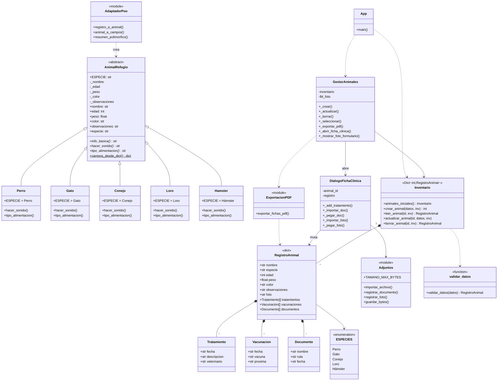
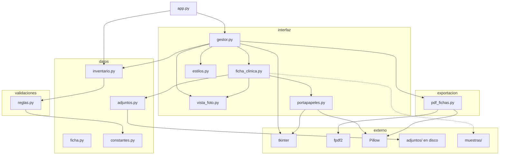
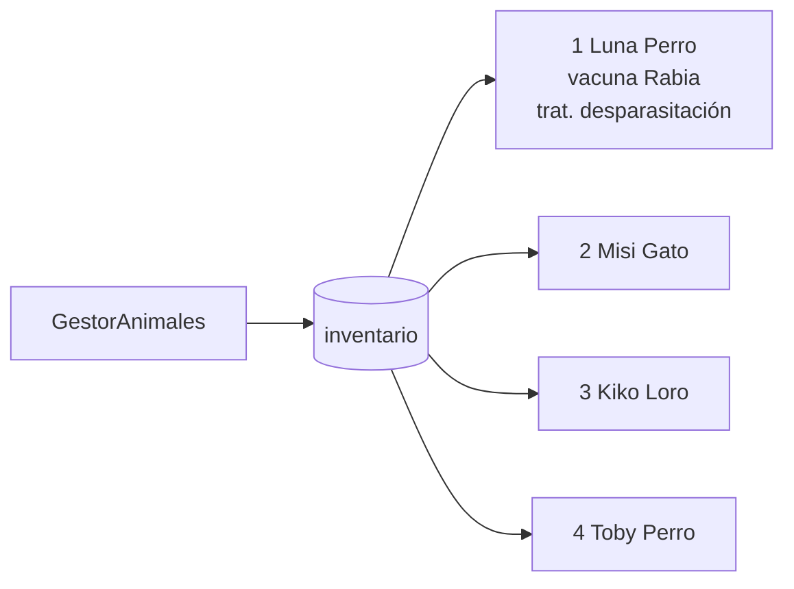
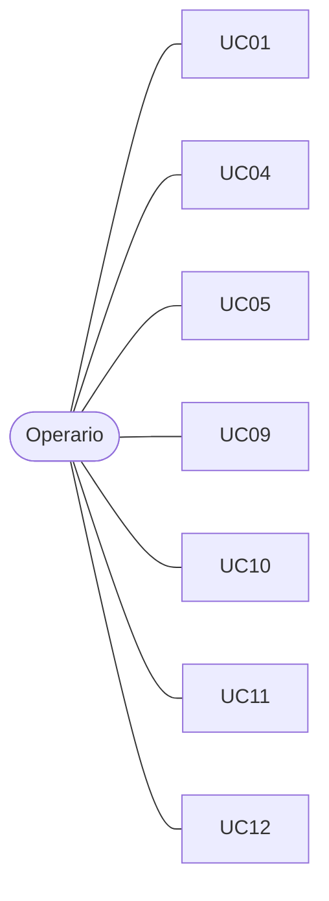
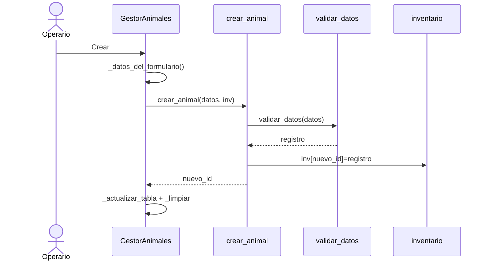
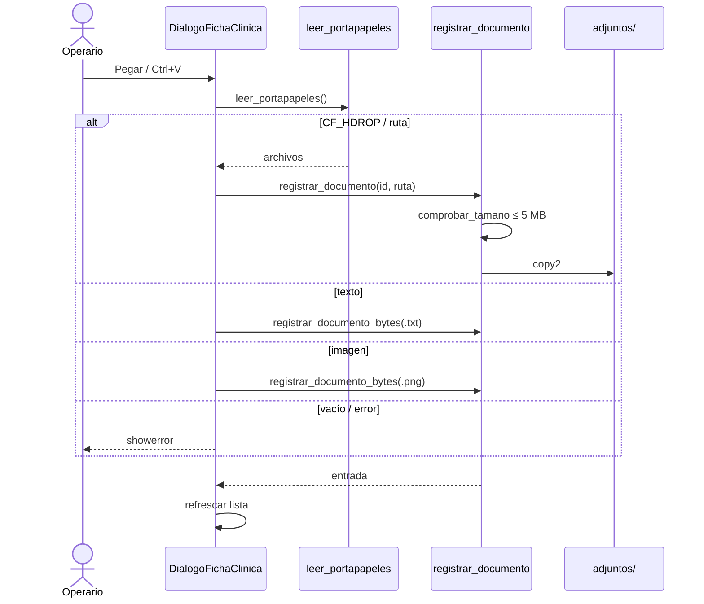
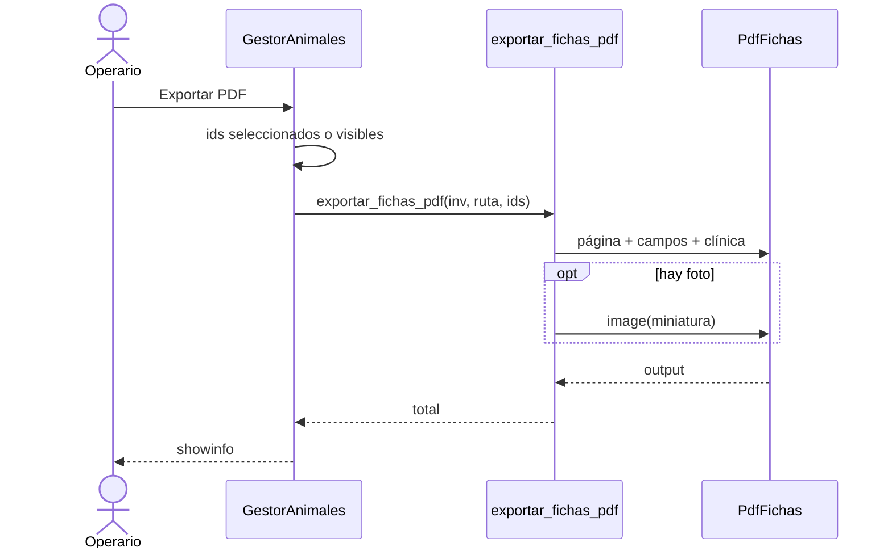
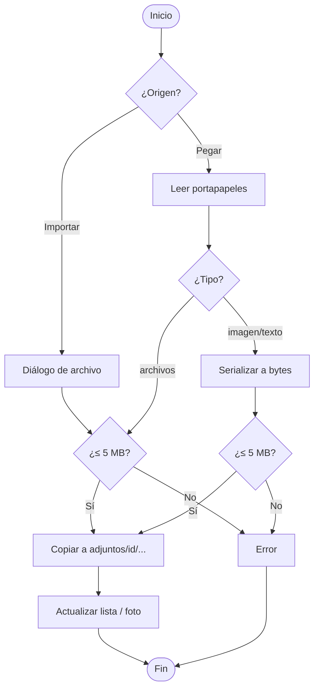
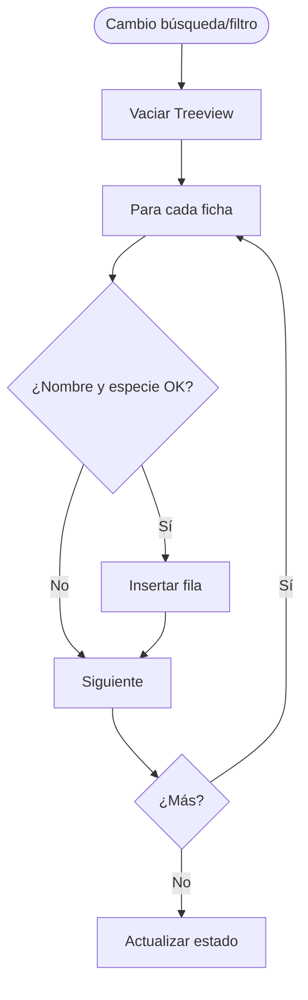

# Modelos UML — Refugio Animal

Diagramas UML habituales aplicados a `tarea1/` (Mermaid).

| Tipo | Sección |
| --- | --- |
| Clases, componentes, despliegue, objetos | [1. Estructurales](#1-diagramas-estructurales-estáticos) |
| Casos de uso, secuencia, actividades | [2. Comportamiento](#2-diagramas-de-comportamiento-dinámicos) |

Catálogo narrativo de CU: [casos_de_uso.md](casos_de_uso.md).

---

## 1. Diagramas estructurales (estáticos)

### 1.1 Diagrama de clases

El **CRUD** usa un **diccionario** (`RegistroAnimal`). En paralelo, capa POO Tema 2: `AnimalRefugio` y subclases. UI: `GestorAnimales`, `DialogoFichaClinica`.



---

### 1.2 Diagrama de componentes



---

### 1.3 Diagrama de despliegue

```mermaid
flowchart TB
  subgraph PC["Nodo: PC del operario"]
    subgraph RT["Runtime"]
      PY[Python 3.8+]
      TKRT[Tk / Tcl]
    end
    subgraph ART["Artefactos"]
      APP[app.py + paquetes]
      MEM[Inventario en RAM]
      DISK[adjuntos/id/fotos|documentos]
      OUT[PDF exportado]
    end
    APP --> PY
    APP --> TKRT
    APP --> MEM
    APP --> DISK
    APP --> OUT
  end
  Op([Operario]) -->|GUI| APP
```

---

### 1.4 Diagrama de objetos (arranque)



Tras pegar un PDF a Luna: `documentos[0].ruta = adjuntos/1/documentos/...`.

---

## 2. Diagramas de comportamiento (dinámicos)

### 2.1 Casos de uso (compacto)



Detalle: [casos_de_uso.md](casos_de_uso.md).

---

### 2.2 Secuencia — crear animal



---

### 2.3 Secuencia — pegar documento



---

### 2.4 Secuencia — exportar PDF con foto



---

### 2.5 Actividades — adjunto (importar/pegar)



---

### 2.6 Actividades — filtrar tabla



---

## 3. Uso en la defensa

| Pregunta | Diagrama |
| --- | --- |
| ¿Cómo está el código? | Componentes / clases |
| ¿Dónde corre? | Despliegue |
| ¿Qué puede hacer el usuario? | Casos de uso |
| ¿Qué pasa al pegar / exportar? | Secuencia |
| ¿Pasos y bifurcaciones? | Actividades |
| ¿Cómo se ven los datos al inicio? | Objetos |

Código de referencia: `interfaz/gestor.py`, `ficha_clinica.py`, `portapapeles.py`, `datos/adjuntos.py`, `exportacion/pdf_fichas.py`.
